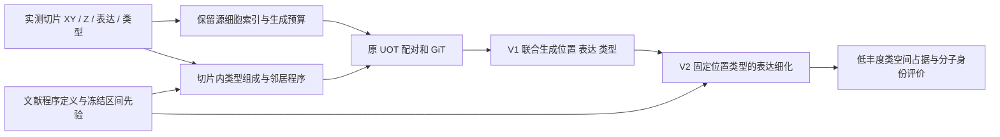

# DeepSpatial 低丰度细胞恢复：明确改造路径

日期：2026-10-26。

依据：《DeepSpatial_生物学机制融合改造研究计划.md》《DeepSpatial_三个关键定义与文献依据.md》；本地源码、已有 MERFISH 分析报告和本次补充文献检索。本文提出方法设计，未实施改造或产生新性能结果。

## 1. 收束后的研究目标

**以少突胶质细胞谱系为主要验证对象，在保留 DeepSpatial 的 UOT 与 GiT 主干的基础上，引入可观测的功能生态位条件，改善低丰度细胞的局部空间恢复和分子状态保真度。**

建议课题表述：**功能生态位条件引导的低丰度细胞三维空间转录组重建**。

首版主方法是 V1 的生态位条件流。低方差源细胞采样与适度的训练重平衡构成保障机制，单独归因；V2 是接在生成后的程序状态细化。三者分别回答“是否获得生成机会”“生成在哪里”“分子状态是否合理”。

本轮保留原 UOT 运输公式，不同时引入新密度模型、完整 GRN 或联合细胞图生成架构。

## 2. 为什么优先解决位置与状态，而非增加稀有类总数

已有 `output/merfish_holdout/analysis/report.md` 记录：三轮留出均有全部 15 类，六个低丰度类也都存在；稀有类宏平均同类空间覆盖率为 50 µm 下 6.64%、100 µm 下 20.55%。OD Mature 3 三轮真值共 8 个、生成共 9 个，三轮 100 µm 覆盖率均为 0。

这些数值来自已有报告，本次没有重新运行其性能计算。同类最近邻覆盖不是一对一恢复率，也受类别密度和生成数量影响；它在当前协议下具体暴露了“数量接近而位置不对”的现象。

已有全输入分析 `output/analysis/report.md` 还记录了均匀来源抽样可能跳过局部稀有源细胞的机制。检查源码可确认，推理以有放回的随机索引抽取来源；未选中的来源不会产生对应轨迹。它与空间速度场是否准确是两个可分别处理的问题。

因此，首个目标设为：**在相同输入、相近生成预算下，提高隐藏区域中低丰度细胞的同类空间覆盖与分子身份可靠性，并控制假阳性。** 不将稀有类预测数量变多单独当作改善。

## 3. 输入、输出与首要生物对象

### 3.1 推理输入

- 配准后的实测切片：每个细胞的 XY、切片物理 Z、表达矩阵与 `cell_class`。
- 真实观测的细胞来源 ID、切片 ID、组织边界，以及采样厚度/间距元数据。
- 训练阶段固定的少量基因程序定义、归一化参数及邻域尺度。
- V2 另需预先拟合并冻结的、与应用邻域定义一致的程序区间预测器。

隐藏切片的表达、类型、区域标签及邻域不作为输入。现有 `Region` 或 `neuron_class` 的来源注释可以用于追溯，不当作生成结果的独立真值。

### 3.2 输出

生成细胞的 XYZ、表达和类型，以及 `parent_id`、来源切片、生成方向、目标深度、连续类别分数、后处理前后表达。原始观测与生成细胞分别标记。

### 3.3 主验证对象

优先关注 OD Immature 2、OD Mature 3、OD Mature 4、OD Mature 1；用同谱系数量较多的 OD Immature 1、OD Mature 2 提供共享信息。已有输入统计中六个 OD 类合计 2,497 个观测细胞，其中 OD Mature 3 只有 14 个。2,497 是观测记录数量，不是独立生物学重复数。

Pericytes、Endothelial 2 作为后续第二类生物场景。不同谱系的程序与先验分别定义，不把所有稀有细胞套入同一个生物过程。

## 4. 生物机制：局部多细胞协同与少突胶质细胞程序

### 4.1 文献实际支持什么

[Zeisel 等，Cell 2018](https://pmc.ncbi.nlm.nih.gov/articles/PMC6086934/) 对少突胶质细胞谱系提出了在共同中间状态后发生次级多样化的解释，并讨论局部环境线索与分级状态变化的关系。这提供机制动机，不能据此把本数据中的 OD 数字标签直接对应到该文的类型或固定成熟顺序。

[DIALOGUE，Nature Biotechnology 2022](https://www.nature.com/articles/s41587-022-01288-0) 在下丘脑 155 基因 MERFISH 数据中识别了跨细胞类型共调控程序，其中包括少突胶质细胞与其他主要脑细胞类型的关联。文中还讨论了包含 Oprl1 及部分激素受体的相关程序。它直接支持当前面板中存在可研究的多细胞功能信息，但未验证本项目四个低丰度 OD 亚类的三维恢复。

[NCEM，Nature Biotechnology 2023](https://www.nature.com/articles/s41587-022-01467-z) 和 [Niche-DE，Genome Biology 2024](https://link.springer.com/article/10.1186/s13059-023-03159-6) 提供了在控制细胞类型后考察邻域关联的建模依据。

### 4.2 本研究采用的机制假设

**少突胶质细胞的状态同时受到谱系身份与局部组织环境约束。即使某一亚类总体低丰度，其周围神经元、星形胶质细胞及其他细胞的组成和功能程序，也可能为它在缺失空间中的位置与状态提供补充信息。**

这里编码的是“环境—状态的统计兼容性”。空间 Z 是组织深度，ODE 是重建参数化；不将其解释成细胞沿 Z 迁移或随深度成熟的真实生物过程。

### 4.3 当前面板如何落到可测量量

本次直接读取现有输出 h5ad 的基因索引，确认共 155 个基因，包含 Mbp、Opalin、Ermn、Gjc3、Pdgfra，以及 Oprl1、Prlr、Esr1、Pgr。

建议先固定两个程序候选：

1. **髓鞘/少突胶质细胞状态的面板内代理程序**：从 Mbp、Opalin、Ermn、Gjc3 等已测基因和公开原始文献定义中确定小基因集。它表示测得的部分状态，不能等同完整髓鞘通路活性，也不能单独区分所有 OD 亚类。
2. **DIALOGUE 公开少突胶质细胞多细胞程序的可测部分**：提取其公开基因列表、方向/权重，与当前面板取交集。上述受体基因是核对候选，不把它们未经核对地当成同方向模块平均。

程序基因和权重从外部证据或训练集固定；强度标准化用训练参数。先比较类型/区域模型与加入邻域模型的增量预测，再决定实际采用的程序。不会把没有增量的程序强行写成有效机制。

## 5. 一条顺序实施的修改路径

### 5.1 先保障源细胞的训练与推理机会

训练保留原 UOT 代价与采样分布作为主要部分，再混入适度的按类型分层训练目标：

\[
\mathcal L_{FM}^{mix}=(1-\eta)\mathbb E_{\pi}[\ell_{FM}]
+\eta\sum_{c\in\mathcal C_{eligible}}q_c\,
\mathbb E_{\pi(\cdot\mid c)}[\ell_{FM}],
\quad \sum_cq_c=1.
\]

其中 \(\pi(\cdot\mid c)\) 首版只使用已有耦合矩阵中两端同为 c 的有效配对；\(q_c\) 可对符合条件的类型等权，\(\eta\) 在验证集固定。端点类别不同时仍由原总体项覆盖；没有有效同类配对的类别不强行构造另一端对应。此目标改变了各类的训练重视程度，须保留仅重平衡的对照。重复抽取同一细胞不会增加独立生物学样本数。

重平衡的思想有成熟长尾学习基础，例如 [Cui 等，CVPR 2019](https://openaccess.thecvf.com/content_CVPR_2019/html/Cui_Class-Balanced_Loss_Based_on_Effective_Number_of_Samples_CVPR_2019_paper.html)；这里的混合 FM 目标是本研究适配，不能直接引用分类论文的性能作为预期增益。

推理保持原总生成预算及来源边际质量，根据原有深度—方向—来源规则的期望质量进行低方差分层分配；在同类来源内均衡选择不同 parent。仅改变 Monte Carlo 分配方式，不使用隐藏真值确定数量，也不强制每个薄层必须出现所有稀有类。预算足够时减少某些已观测稀有源完全未被选择的机会。

分层抽样保障的是来源机会，后续输出的类别漂移和位置仍需检查；它不提供缺失体积真实细胞数的估计保证。

### 5.2 用少量功能生态位特征构成 V1 条件

在源细胞所在实测切片内，按物理半径排除自身，构造

\[
H_i=\operatorname{concat}
\left(\mathbf n_i^{type},\mathbf n_i^{program},\mathbf q_i^{support}\right).
\]

\(\mathbf n^{type}\) 是距离核加权的邻居类型组成；\(\mathbf n^{program}\) 是少量经文献定义、在当前面板可测的邻居程序统计；\(\mathbf q^{support}\) 为有效邻居数、加权观测量与缺失标志。分子程序必要时按主要邻居类型聚合，防止只反映细胞组成。目标细胞自身不进入邻域聚合。

这一步在第二份文档“先做类型组成”的基础上增加少量功能特征，目的是让“功能生态位”有可检验内容；类型组成单独作为关键对照。仍使用线性投影，暂不引入新 GNN。

每条轨迹携带固定的源条件：

\[
\mathrm{cond}'_t=\mathrm{cond}_t+W_HH_{source},
\qquad H_{source}(t)\equiv H_{source}.
\]

同一条件进入联合速度场，所以位置头、表达头和类别头都可利用它。正反向分别使用各自源细胞条件，反向训练增强同步用于对照。目标是利用源上下文选择更合适的运输行为，不假设插值位置的真实三维邻域已知。

### 5.3 在谱系内共享程序先验，再开展 V2

低丰度亚类不各自训练一个独立大预测器。建议共享谱系层的邻域效应，并对亚类偏移正则化，例如

\[
Q_{\tau,k}(P_k\mid H,L,c)
=a_{L,\tau,k}+B_{L,\tau,k}H+b_{c,\tau,k},
\]

其中 \(L\) 为少突胶质细胞谱系，\(c\) 为具体亚类；\(b_c\) 的收缩强度在训练/验证确定。它在共享信息与保留亚类差异之间折中，不把少量亚类强行改成谱系均值。

V1 完成后，V2 固定生成位置、类型与观测细胞，仅细化虚拟细胞表达。沿用第二份文档的区间惩罚与基础表达偏离约束：

\[
\mathcal L_{refine}=\lambda_{bio}\sum_{i,k}
\frac{[L_{ik}-\hat P_{ik}]_+^2+[\hat P_{ik}-U_{ik}]_+^2}{s_k^2}
+\beta\sum_i\|D_g^{-1}(\hat g_i-g_i^{base})\|_2^2.
\]

范围来自真实训练/校准数据，区间内不产生向均值的额外收缩。统计工具参考 [CQR，NeurIPS 2019](https://papers.neurips.cc/paper_files/paper/2019/hash/5103c3584b063c431bd1268e9b5e76fb-Abstract.html)。它只改善表达的候选保真度；此版的位置、数量不会因 V2 改变。

**V2 的明确顺序条件：** 三维邻域先验需在训练用真实三维块上拟合和校准，再用于相同定义的生成邻域。现有 DeepSTARmap 文件的元数据包含 198,675 个细胞、三维 `spatial` 坐标及 FUSEmap 注释，可作为待核验的数据入口；本次只检查了结构，没有确认其原始测量、单位、样本独立性或标签与 MERFISH 的对应。不直接把外部不同技术上的关系权重迁移到 MERFISH，也不把二维先验直接输入完整三维邻域。当前可先独立完成采样保障与 V1，V2 随三维训练材料核实后接入。

## 6. 对低丰度细胞恢复的理论提升来自哪里

### 6.1 降低纯抽样遗漏：最直接、可证明的改进

在给定方向内，从 N 个源细胞均匀有放回抽取 M 次，某个源细胞未被选中的概率是

\[
\Pr(\text{source omitted})=(1-1/N)^M.
\]

已有内部报告的端点例子是 N=5,543、M=14,116，对应约 7.8%。分层并均衡 parent 覆盖可以在预算允许时降低这种遗漏。它改善来源覆盖，不保证生成点最终落在正确位置。其收益在仅采样对照中单独报告。

### 6.2 减少稀有亚类内部的轨迹歧义：V1 的主要价值

即使类型相同，相似表达的少突胶质细胞也可能处于不同局部环境。低丰度类别很少有足够样本让模型仅凭自身状态区分这些环境；周围较多的神经元/胶质细胞可以提供更稳定的上下文描述。

在固定训练耦合及目标速度 U 下，令 S 为原模型输入，H 为新增可观测条件。对稀有类 c 的理想平方损失预测器，有

\[
R_c^*(S)-R_c^*(S,H)
=\mathbb E\!\left[
\|\mathbb E[U\mid S,H,c]-\mathbb E[U\mid S,c]\|^2
\mid c\right]\ge0.
\]

这是条件期望的正交分解：当 H 提供原输入之外的信息时，理想预测器可以减少将不同环境下的速度混在一起的误差。这为联合位置/表达生成提供理论动机。若 H 没有额外信息，右侧可以等于零。

该式针对固定监督目标、无限数据和足够表达能力的最优风险；并不保证有限模型或隐藏组织恢复必然改善。尤其 UOT 对应错误时，更好拟合 UOT 监督不能自动修正真值位置。因此主张的是“上下文有机会减少歧义”，由独立隐藏空间评价检验其重建作用。

### 6.3 借用谱系共性：减轻稀少样本的估计方差

对 OD Mature 3，仅有 14 个观测细胞时，独立学习复杂生态位到程序关系不稳定。共享谱系层效应可让较多的同谱系观测估计共性，仅由稀有亚类估计少量偏移。真实亚类接近共享规律时，这种部分共享可降低估计方差；若亚类确实独特，收缩会引入偏差，所以保留亚类残差并以验证集选择强度。

信息共享不等于将全部 OD 当作同一类，也不会凭空增加少数亚类的独立观测。

### 6.4 保留允许的状态差异：V2 的作用

点回归损失会对所有偏离预测均值的细胞施加梯度；区间损失对范围内的细胞不产生此类梯度。因此它可减轻由 NPC 自身造成的向均值收缩，并纠正超出支持范围的程序偏移。

这有利于在分子层面保留低丰度细胞候选的状态，但区间不保证亚类独有标记、多峰结构或极端激活状态完整保留；需连同独立 marker 与程序分布检查。先验采用单细胞预测区间，而非条件均值的置信区间。

### 6.5 各类收益的明确归属

| 恢复问题 | 哪一处改动直接作用 | 理论预期 |
|---|---|---|
| 观测稀有来源完全未被抽中 | 低方差来源分配 | 减少纯抽样遗漏 |
| 稀有类训练梯度被总体目标弱化 | 适度分层训练 | 增加优化关注，最终效果仍由数据决定 |
| 数量接近但局部位置错误 | V1 功能生态位条件 | 条件信息有效时减少运输歧义，是主要重建假设 |
| 生成细胞标签与分子身份不匹配 | V1 表达生成与 V2 程序细化 | 改善程序兼容性，并由外部标记核验 |
| 均值约束压缩状态差异 | V2 区间惩罚 | 区间内没有额外向均值的梯度 |
| 两侧均无该类且无可用先验 | 当前路径没有专门的类型出现/数量模型 | 不承诺从零发现此类，真实数量也没有恢复保证 |

## 7. 与相关方法相比，具体增加了什么

| 方法 | 已有能力 | 本路径的比较重点 |
|---|---|---|
| DeepSpatial | UOT、类型条件、位置/表达/类别联合流与连续 Z 生成 | 增加细胞间的可观测功能上下文，单独处理低丰度来源机会，考察同类局部恢复 |
| BANKSY、NCEM、Niche-DE、NicheCompass | 邻域表征、环境关联或程序引导分析 | 将经独立检查的关系用于隐藏空间的生成与细化；邻域关联本身不作为新发现 |
| STITCH-n | 动态邻域与固定真实上下文耦合的生成流 | 比较具名功能程序、区间容许与低丰度局部恢复带来的额外作用；不声称首次将邻域接入流 |
| NicheFlow | 以源微环境点云为条件，联合生成状态和坐标，研究时间序列微环境变化 | 保留单细胞生成接口，研究稀疏空间切片插值和低丰度恢复；时序轨迹与空间深度插值分开表述 |
| 仅重平衡或增加稀有种子 | 改变优化关注或来源覆盖 | 在相同来源机会、相近预测数量下，功能生态位还应带来位置/分子收益 |

[STITCH v1，2026 预印本，第 4.4.2 节](https://www.biorxiv.org/content/10.64898/2026.06.03.729557v1.full) 与 [NicheFlow v2，2025 预印本，第 3.3、4 节](https://arxiv.org/html/2511.00977v2) 均已核查相关方法段落。该表为机制和问题定位，不是性能排名。

最有价值的潜在贡献是：**识别总体计数和全局表达指标掩盖的低丰度局部恢复缺口，并检验功能生态位信息是否能在控制采样与模型容量后改善该缺口。** 目前不能将已知组件的组合直接称为已确立的新方法优势。

## 8. 代码落点与最小验证顺序

| 顺序 | 改动 | 文件落点 | 第一项应核查的量 |
|---|---|---|---|
| 1 | 追溯来源、保存连续类别和后处理前表达 | `core.py`、`module.py` | parent 覆盖、类别漂移、marker 稀疏化损失 |
| 2 | 低方差来源分配、训练分层混合 | `core.py`、`dataset.py`、`module.py` | 总预算、各类来源预算和有效配对支持 |
| 3 | 切片内功能生态位预计算，源条件传递 | 新 `bio_prior/`、`dataset.py`、`git.py`、`module.py`、`core.py` | 输入无隐藏真值，训练/推理条件一致 |
| 4 | 谱系共享的程序区间先验 | 新 `bio_prior/` | 留出校准覆盖、亚类偏差、测量尺度一致 |
| 5 | 固定位置/类型的 V2 表达细化 | 独立推理细化入口 | 程序误差、marker 分布及表达改变量 |

先以相同可见切片和密度重做已有留出评价。比较至少保留：原版、仅采样/训练重平衡、仅普通邻域类型条件、真实功能程序条件，以及打乱程序关系条件。V2 相对 V1 另看增量。

主要终点为低丰度同类空间占据/覆盖与独立分子身份，配合数量误差和假阳性；优先比较相近预测数量下的结果。上述三张留出切片此前已用于方向选择，应视作开发证据，后续独立测试另留组织/体积，不能将反复调参后的同一结果包装成全新测试。

首轮最值得检验的陈述是：**在同样能生成 OD Mature 3、OD Immature 2 等类别、并控制采样机会之后，功能生态位条件是否让生成细胞更接近真实出现区域，同时保持正确的分子状态。** 对提升幅度暂不给百分比承诺。

## 9. 本轮新增或强化的参考依据

- [DIALOGUE，Jerby-Arnon 与 Regev，Nature Biotechnology 2022](https://www.nature.com/articles/s41587-022-01288-0)：同类下丘脑 155 基因面板中的跨类型程序，核查 Results 的 brain patterning 与行为关联段落。
- [Molecular Architecture of the Mouse Nervous System，Zeisel 等，Cell 2018](https://pmc.ncbi.nlm.nih.gov/articles/PMC6086934/)：少突谱系次级多样化及环境响应解释，核查 Fig. 4 和 Discussion；其机制解释作为动机而非本项目事实。
- [Class-Balanced Loss，Cui 等，CVPR 2019](https://openaccess.thecvf.com/content_CVPR_2019/html/Cui_Class-Balanced_Loss_Based_on_Effective_Number_of_Samples_CVPR_2019_paper.html)：长尾重平衡的既有基础，未将视觉分类结果迁移为生物重建结论。
- [NicheFlow，Sakalyan 等，arXiv:2511.00977v2，2025](https://arxiv.org/html/2511.00977v2)：源微环境条件与联合点云生成，用于界定已有能力。
- [STITCH，Wang 等，bioRxiv v1，2026](https://www.biorxiv.org/content/10.64898/2026.06.03.729557v1.full)：邻域耦合流，用于具体比较。
- [Niche-DE，Mason 等，Genome Biology 2024](https://link.springer.com/article/10.1186/s13059-023-03159-6)、[NCEM，Fischer 等，Nature Biotechnology 2023](https://www.nature.com/articles/s41587-022-01467-z)、[NicheCompass，Birk 等，Nature Genetics 2025](https://www.nature.com/articles/s41588-025-02120-6)：程序与邻域关系的模型基础，其余定义与校准参考沿用第二份文档。

本次未构建完整配体—受体网络。当前面板不含 Pdgfb、Pdgfrb，因此本路径没有把 PDGF-B–PDGFRβ 设为已测量或已验证的主机制。未来若采用更完整的基因面板，再根据原始生物证据选择具体信号轴。
