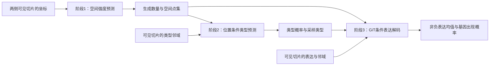

# ST_DeepSpatial：空间 → 类型 → 表达

独立实验版本，继续使用原来的 5 张 MERFISH 切片。与 `HM_DeepSpital`、`RC_DeepSpatial` 同级；原模型代码、已下载指标和重建文件保持原样。此实现尚未完成正式多折训练，不能据此声称稀有细胞恢复提高。



## 与 DeepSpatial 的关系

保留原 GiT 的位置 token、基因分块、类型/深度条件嵌入和 Transformer blocks。第三阶段把原基因速度头改作**静态正表达幅度修正**，新增邻域适配器及基因出现概率头；丢弃位置和类型输出，不再进行三种状态的联合 ODE 积分。GiT 源文件为原代码的未修改快照，见 `reuse_manifest.json`。

这不是上一版 ABC 模块的开关，也不与原 checkpoint 权重直接兼容。各模块从头训练，已有 DeepSpatial/control 结果保留为比较基线；不得把这版结果称作原 DeepSpatial 的复现。

## 三个阶段具体做什么

1. **空间模块 S**：仅读取两侧切片坐标。以 25 µm 网格上的平滑密度插值为初值，MLP 学习有界对数强度修正，用 Poisson 损失监督。生成时先按预测总强度采样数量，再从网格强度分布采样位置，在网格内均匀抖动。没有来源细胞、类型配额或稀有类型补点；z 按 10 µm 厚度的固定层中心安排。
2. **类型模块 T**：在生成位置查询两侧可见切片的局部类型组成、支持量和相对几何，预测类别概率，再采样最终类型。没有继承任何来源标签。保存 argmax 类型及其独立指标，避免把采样带来的少数类数量误认为学到了定位。默认使用自然分布交叉熵；可配置风险权重，但不能凭测试集调权。
3. **表达模块 G**：固定坐标与预测类型，用邻域表达适配器 + GiT 预测基因出现概率和正表达幅度。输出 `E[X | 位置, 预测类型, 邻域]`，训练采用 log-MSE、按训练基因尺度归一化的 Huber、出现概率 BCE 和正值 log-MSE。不同损失分别记录。训练时输入冻结的第二阶段预测类型，而非真实类型，显式承受上游错误。

表达均值一般是稠密的，并不代表每个基因都真实出现。`expression_presence_probability` 专门保存出现概率；不再沿用原版的“保留来源细胞非零基因数”的稀疏化。比较稀疏性时应使用出现概率 BCE 等诊断，不能仅比较均值矩阵的正值比例。

## 训练数据隔离

- 外层 heldout 及 `--excluded` 切片在训练和生成阶段均不打开。所有词表、范围、尺度和网格仅由可见切片确定。
- 空间模块：逐张遮住可见的内部切片，用其最近两侧可见切片预测该切片密度；默认每折只有 **2 个空间监督任务**，这限制了可学规律的可靠性。
- 类型、表达模块：逐张排除目标切片本身，再查询其他可见切片。边界训练切片用单侧上下文；生成隐藏内部切片时用两侧上下文。
- 第三阶段的训练类型来自第二阶段对训练位置的预测采样。它仍是第二阶段的训练内预测，**不等同于折外预测**；训练和测试的分类错误分布仍可能不同。
- 全部生成完成后才打开隐藏切片做评估；oracle 诊断不会反馈到训练、采样或模型选择。
- 少于 3 张可见切片不能训练空间模块，会明确拒绝。使用外层测试排除时，要保证还有足够可见切片。

## 运行

复用现有 MERFISH PyTorch 环境，只安装缺失依赖。项目可独立上传；数据位置通过配置的 `input_glob` 指定，无需上传 HM/RC 的源码。默认沿用同级 `data/merfish_mouse_hypothalamus` 下的数据。

先跑一折完整模型和无需额外训练的干预：在工作区根目录执行

```bash
python ST_DeepSpatial/examples/run_merfish.py --holdouts 2 --interventions
```

同配置、源码和输入文件继续运行：

```bash
python ST_DeepSpatial/examples/run_merfish.py --holdouts 2 --interventions --resume
```

三折正式开发实验：

```bash
python ST_DeepSpatial/examples/run_merfish.py --holdouts 1 2 3 --interventions
```

默认每折训练 3 个模块，轮数为 S=30、T=30、G=40。三折共 **9 次模块训练、300 个模块 epoch**；干预只额外生成、评估，不额外训练。时间需由实际设备测量。可分别运行 `--stage train/generate/evaluate`，后续阶段须加 `--resume`。改变配置/源码/实验变体时使用新 `--output`，不要覆盖已有实验。

Notebook 入口：`examples/run_merfish.ipynb`，默认先跑 holdout=2；改 `HOLDOUTS=[1,2,3]` 可跑三折。

## 消融与机制证据

新增变体需放到新的输出目录，例如：

```bash
python ST_DeepSpatial/examples/run_merfish.py --holdouts 2 --output ST_DeepSpatial/outputs/merfish_staged_ablation_v1 --variants full spatial_linear type_prior expression_no_type expression_no_niche --interventions
```

空间与类型模块共享训练一次，完整表达模块和三个相关表达消融各训练一次，共 **6 次模块训练/折**。

| 实验 | 控制方式 | 对应的问题和证据 |
|---|---|---|
| `spatial_linear` | 用可见端点密度插值替换学习修正，复用完整 T/G | 学习修正是否改善隐藏密度和数量？看密度 TV、Poisson NLL、数量误差，不能仅看最终稀有 F1 |
| `type_prior` | 用当前位置的可见邻域类型比例替代分类残差；重训下游 G | 分类网络是否超过邻域先验？看真实位置上的 NLL/Brier、每类召回和最终空间 F1 |
| `expression_no_type` | 训练时、生成时均去掉目标预测类型通道；重训 G | 给定位置与同一邻域，目标类型是否仍提供表达信息？保留邻域类型组成，因此检验的是目标类型通道 |
| `expression_no_niche` | 去掉邻域表达输入及局部表达基准，改用可见训练全局基准；重训 G | 局部实测表达是否提供额外信息？仍保留位置、目标类型和邻域类型几何 |
| `type_position_shuffle` | 完整模型上打乱位置对应的全部类型特征，再预测类型 | 分类是否依赖空间对应关系？固定点集；属于推理干预，不是重训消融 |
| `expression_type_shuffle` | 固定点集和已报告类型，仅打乱传入 G 的预测类型 | G 是否使用类型信息？比较表达误差和类型一致性；推理时可能越出训练分布 |
| `expression_niche_shuffle` | 固定点集/类型，打乱局部表达特征及基准 | G 是否使用位置匹配的邻域表达？不要将干预下降直接解释为因果机制证明 |

额外的**真实位置诊断**：

- 在真实隐藏位置上，用可见切片上下文预测类型，比较 learned / local prior / shuffled position 的 NLL、Brier、每类召回。用来隔离空间点集误差。
- 在相同真实位置比较预测类型、真实类型、打乱类型、打乱邻域对应的逐细胞表达误差与出现概率 BCE。真实类型只适用于训练词表已见类别。Oracle 改善说明上游可能是瓶颈，并不保证替换上游就能获得同等端到端收益。
- 所有位置都是真实测量位置，故这些逐细胞表达比较有对应关系；生成点与真实点之间不假定个体对应。

## 输出

默认根目录 `outputs/merfish_staged_v1`：

```text
all_runs.csv
experiment.json
holdout_2/seed_42/
  spatial/last.pt, training.csv
  type/last.pt, training.csv
  expression_full/last.pt, training.csv
  stage1_spatial_distribution.npz   # depths_um, grid_xy, intensity
  stage1_points.npy                # N×3，真实物理单位
  stage1_counts.csv                # 每层预测数量均值与采样数量
  stage1_density_diagnostics.csv   # learned/linear 的隐藏密度和数量诊断
  oracle_position_type_by_class.csv
  oracle_position_type_scores.csv
  oracle_position_expression_interventions.csv
  full/
    predicted_gap.h5ad
    predicted_holdout.h5ad
    metrics.json
    per_type.csv
```

H5AD 中 `X` 为预测表达均值，`obsm['spatial_3d']` 为坐标，`obs['cell_class']` 为采样预测类型，`obs['cell_class_argmax']` 为最大概率类型，`obsm['cell_type_probabilities']` 为完整概率，`layers['expression_presence_probability']` 为基因出现概率。类型概率需要校准检验，不能直接解释为可靠置信度。

为复用旧评估，`parent_id` 是生成点 ID，`generation_mode` 是 `spatial_intensity`；因此 `unique_parents` 不再具有原版“来源细胞覆盖数”的含义。`source_anchor_fraction=0` 也不代表所有点都有实测支持，应看 `empty_neighborhood`。

## 当前边界

- 这是有条件的网格 Poisson 点过程，未建模细胞间排斥、单细胞谱系或连续三维个体轨迹。各层独立采样，不能把相邻层点当作同一细胞。
- 空间模块不使用类型，可能漏掉只由稀有类型形成的小区域；第二阶段也不能在没有生成点的地方补细胞。它不能保证稀有恢复改善，更不能保证原指标不退化。
- 25 µm 网格及网格内均匀采样限制空间精度；需要预设网格尺度敏感性实验，不能按测试 F1 选尺度。
- 表达输出从联合 FM 改为条件均值解码，GiT 的时间输入固定为 1；原 FM 目标和连续轨迹的性质不能沿用到这里。
- 概率采样可能使稀有类型更常出现，但这是表示后验不确定性，不是恢复能力的独立证据。应同时报告 argmax、多个采样/训练种子、位置条件概率评分及密度保持的随机参考。
- 当前三折来自同一系列、并非独立生物重复；没有提前设定非劣效界或正式多种子结果，不能声称“基本不影响原指标”。

工程检查：`python -m unittest discover -s ST_DeepSpatial/tests -v`。覆盖隐藏切片隔离、阶段依赖、独立干预、保存/恢复和中断续训；真实数据单轮短程运行也只验证流程，不作为性能证据。
