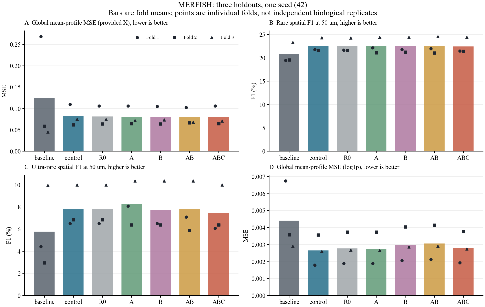
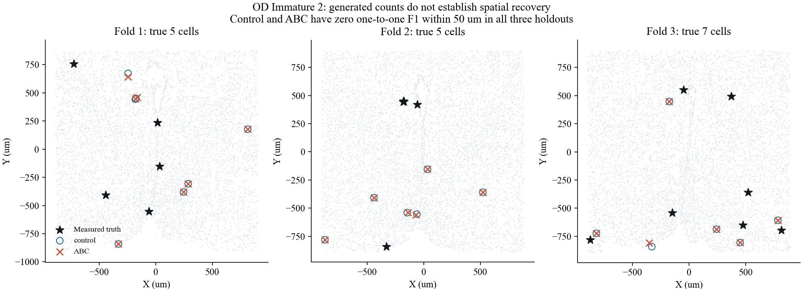

# RC DeepSpatial：MERFISH 21 组结果分析

分析日期：2026-11-01。数据来源：`RC_DeepSpatial/outputs/merfish_v1/`。本次只读既有模型、重建和指标，另外做了不训练模型的坐标替换、标签置换诊断；没有更改原始实验结果。

## 结论

这一轮说明：脚本中的 control 已取得相对 baseline 的主要改善；新增 A/B/C 并没有形成稳定的额外稀有类空间恢复优势。完整 ABC 相对 baseline 的三折平均数变好，但这不能归因于 A/B/C，也不能解释为各折原有指标均得到保持。

最有价值的发现有三项：

1. 极稀有类的可匹配支持确实不足，A 只能在已有支持上重新分配监督，无法补出不存在的跨切片候选。
2. control 的空间输出非常接近来源复制，平均只移动 1.53 µm；固定数量与来源后，直接保留来源 XY 的稀有类 F1 已为 22.21%，control 为 22.55%。
3. 类型数量与空间/表达恢复必须分开。21 个预测薄层的生成类型全部与来源类型一致，因此“所有类型都有生成”主要依赖来源调度与类型保持，不能单独证明网络恢复了稀有细胞。

另一方面，最稀有类型每折只有几个真值细胞，50 µm 匹配极易为零。随机标签诊断也经常得到零分，不能把单个零 F1 直接解释为模型在生物学意义上完全失败。

## 1. 完整性与比较边界

- 3 个留出折（1/2/3）× seed 42 × 7 臂，共 21 组，全部训练、生成和评价完成，每组有 100 个连续 epoch。
- 检查了可见输入、隐藏评价输入、21 个检查点、21 个完整间隙重建和 21 个薄层预测的 SHA-256，均与记录一致。
- 对照保存的源码哈希，本机 4 个 vendor 文件只有 CRLF/LF 换行差异；统一 LF 后所有源码与运行记录相符，没有发现算法内容差异。
- CSV 汇总与逐组 JSON 数值一致；从预测 H5AD 独立重算了 21 组稀有/极稀有 50 µm 一对一 F1、原始表达基因均值 MSE，与结果记录一致。
- control 和全部残差臂精确共享生成调度；残差臂使用相同 control 主干检查点。训练参数、输出数量、词表和基因顺序符合运行配置。
- 只有一个随机种子，且三折来自同一套相邻切片，折间不是独立动物重复；本文不报告生物学显著性或非劣性成立。
- baseline 是本脚本中原 GiT、全局 UOT、单向训练及随机来源的实现。control 同时改变局部支持、双向训练和来源调度。其增益不能进一步归到这三项中的某一项。
- R0/A/B/AB/ABC 在预训练 control 上追加 100 epochs 残差训练；与 control 比较时多出了训练开销。R0 是分析新增模块时更合适的同容量、同追加训练量对照。

审计证据：`audit.csv`、`source_audit.csv`、`recomputed_metrics.csv`。

## 2. 主指标：平均提升主要来自 control

以下为三个留出折的算术平均。rare 为可见训练丰度 ≤5%，ultra-rare 为 ≤1%。空间 F1 是同类、50 µm 截断的一对一最大匹配 F1，百分数表示；不是逐细胞身份分类准确率。MSE 是基因均值表达向量误差，不是有真实一一对应的细胞级表达误差。

| 方法 | 原始 X MSE ↓ | log1p MSE ↓ | log1p PCC ↑ | rare 空间 F1 ↑ | ultra-rare 空间 F1 ↑ | 表达 probe 下 rare 空间 F1 ↑ | common 空间 F1 ↑ |
|---|---:|---:|---:|---:|---:|---:|---:|
| baseline | 0.124069 | 0.004414 | 0.991736 | 20.77% | 5.78% | 20.99% | 64.26% |
| control | 0.082306 | 0.002656 | 0.995850 | 22.55% | 7.79% | 22.44% | 65.48% |
| R0 | 0.081563 | 0.002768 | 0.995790 | 22.51% | 7.79% | 22.42% | 65.37% |
| A | 0.080773 | 0.002763 | 0.995805 | 22.55% | 8.28% | 22.67% | 65.38% |
| B | 0.080885 | 0.002990 | 0.995628 | 22.47% | 7.75% | 22.52% | 65.48% |
| AB | 0.079076 | 0.003060 | 0.995542 | 22.52% | 7.78% | 23.30% | 65.54% |
| ABC | 0.080640 | 0.002816 | 0.995778 | 22.44% | 7.48% | 22.42% | 65.70% |

ABC 相对 baseline 的平均原始 X MSE 降低 35.00%，rare F1 增加 1.672 个百分点。但 control 已将平均原始 X MSE 降低 33.66%，rare F1 增加 1.776 个百分点。

ABC 相对 control：原始 X MSE 再降低 2.02%，log1p MSE 反而增加 6.04%，rare F1 降低 0.105 个百分点，表达 probe 下 rare F1 降低 0.017 个百分点。因此完整方案尚未超过共同基础 control 的整体权衡。

数据：`main_means.csv`。图中点是各留出折，柱为折间平均，不是独立生物学重复的误差线。

## 3. 平均数掩盖了部分折的表达退化

| 留出折 | baseline 原始 X MSE | ABC 原始 X MSE | ABC 相对变化 | ABC 的 rare F1 相对 baseline 变化 |
|---|---:|---:|---:|---:|
| 1 | 0.268146 | 0.106063 | −60.45% | +2.000 个百分点 |
| 2 | 0.058943 | 0.064756 | +9.86% | +1.885 个百分点 |
| 3 | 0.045117 | 0.071102 | +57.60% | +1.130 个百分点 |

原始表达平均改善很大一部分来自第 1 折对较高基线误差的修正。第 2、3 折的原始 X MSE 增加；第 2 折 log1p MSE 也增加 5.25%。

这批结果不能支持“各折原有指标基本保持，同时恢复稀有类”这一强表述。尚未预声明可接受退化阈值，也没有足够独立重复进行正式非劣性判断；但 +57.60% 的某折原始 X MSE 已经值得单独解释，不能被平均值抵消。

## 4. A：训练边际问题存在，最终恢复收益很小

三个折的轨迹库各为 50,000 条。下表为三个轨迹库的条目合计，不是 150,000 个独立生物学样本，也不再乘以反复训练的 100 epochs。

| 类型 | control 轨迹数 | A/AB/ABC 轨迹数 | A 组权重被 cap=10 截断的条目 |
|---|---:|---:|---:|
| Endothelial 2 | 87 | 259 | 83 |
| OD Immature 2 | 1 | 20 | 20 |
| OD Mature 3 | 0 | 4 | 4 |
| OD Mature 4 | 16 | 54 | 54 |
| Pericytes | 277 | 442 | 19 |

A 确实增加部分稀有类型进入训练的机会，这一机制有直接中间证据。但：

- OD Mature 3 在第 1 折完全没有可用局部支持，A 仍然采不到一条轨迹。
- OD Immature 2 和 OD Mature 3 的合计条目仍只有 20 和 4；风险再加权不能产生新的独立来源或新的组织几何信息。
- 对最稀有的三类，进入 A 轨迹库的条目全部被权重上限截断；不能宣称此时实现了理想的完全类别平衡风险。

A 相对 R0 的 rare F1 平均只增加 0.043 个百分点，三折中 2 折增加、1 折降低。ultra-rare F1 从 7.79% 增至 8.28%，属于可以继续验证的弱正信号，但不足以说已解决极稀有细胞恢复。

此外，这轮 A 同时启用边际校正和类别风险混合，未运行 `AB_risk_only` / `AB_marginal_only`，因此不能在两者之间进一步归因。

证据：`sampling.csv`，原运行目录的 `shared/transport_local.csv`、`matching_support.csv`。

## 5. 极稀有类型：数量保留与空间恢复脱节

在 ABC 的三个评价薄层中：

| 类型 | 生成数合计 | 来源锚定数 | 锚定比例 | 平均 50 µm 一对一 F1 |
|---|---:|---:|---:|---:|
| OD Immature 2 | 19 | 13 | 68.42% | 0 |
| OD Mature 3 | 8 | 7 | 87.50% | 0 |
| OD Mature 4 | 29 | 10 | 34.48% | 3.51% |

这些细胞在文件中存在，很多由无支持端点直接保留来源位置、表达与类型，只改变深度。它们没有被删除，这保证评价完整，但不能将其存在解释为模型已学会隐藏组织中的位置。

重新读取 21 个预测薄层发现，所有生成细胞的 `cell_class` 都与 `source_cell_class` 相同。类型保持本身可以是合理设计，但“没有漏掉某个类型”主要反映来源调度和类型保持；稀有类恢复还需要空间、表达或生态位证据。

图中星号为真值，圆圈为 control，叉号为 ABC。control/ABC 在 OD Immature 2 上的位置非常接近，但与少量真值点未达到 50 µm 匹配标准。

### 低密度随机参考

为避免把低密度点云中的零匹配过度解释，固定 control 的生成位置、总数和各类数量，仅随机置换细胞类型标签 100 次。这是事后结构诊断，不用于模型选择，不是额外训练，也不是生物学重复。

OD Immature 2 在三折中，随机置换后 F1 为零的比例分别为 86%、94%、94%；OD Mature 3 为 99%、100%、99%。所以，零 F1 本身不能证明比随机更差，也不能证明生物学恢复完全失败。它说明当前协议在这些每折仅几个细胞的类型上有很强的离散性和低密度限制。

合理的后续证据应同时包含密度保持的随机参考、较粗尺度的类型空间分布、生态位分布及表达一致性，不能只优化某个 50 µm 点匹配数字。

证据：`anchor_counts.csv`、`rare_class_f1_percent.csv`、`label_permutation_reference.csv`。

## 6. 空间运动：接近来源复制，比“模块删掉后掉分”更关键

将每个已生成 control child 的 XY 替换为其真实来源 XY，保留全部数量、类型、表达和目标深度；另用同一来源、同一对端候选做线性 OT 位置插值。没有重训，也没有使用隐藏位置选择候选。

| 位置规则 | rare F1，50 µm | ultra-rare F1，50 µm |
|---|---:|---:|
| 直接来源 XY，固定同一批 child | 22.21% | 7.42% |
| control 学习的 XY | 22.55% | 7.79% |
| 同候选 OT 线性 XY 插值 | 21.73% | 6.57% |

因此 control 的空间运动相对来源 XY 的平均收益只有 0.337 个百分点；这与“完整生成流程相对 baseline 的改善”是不同的问题。

相对来源位置的平均位移为：baseline 55.57 µm、control 1.53 µm、R0 1.76 µm、A 2.72 µm、B 2.07 µm、AB 3.89 µm、ABC 3.17 µm。

另一方面，实际训练配对的端点物理距离平均为：baseline 334.50 µm、control 31.23 µm、A 36.33 µm。局部 UOT 确实显著缩短了训练配对距离，但模型最终产生的位移比这些端点距离还小很多。

这支持“局部配对＋条件回归可能产生接近静止的平均速度场”的诊断方向。它尚不构成对具体优化原因的证明：局部多候选方向平均、空间/表达损失尺度、对端方向信息不足及配对误差都可能参与。

OT 线性插值没有优于 control，进一步说明不能只强迫模型运动到现有候选。候选是否反映可识别的组织结构需要先验证。

证据：`spatial_counterfactuals.csv`、`source_movement.csv`、`training_endpoint_distances.csv`。

## 7. B 和 C 的证据怎样理解

### B：没有稳定空间收益，环境机制尚未建立

B 相对 R0：rare F1 降低 0.036 个百分点；表达 probe 下 rare F1 增加 0.102 个百分点，但全局 log1p MSE 增加 8.01%。

AB 相对 A：模型类别下 rare F1 降低 0.030 个百分点，表达 probe 下增加 0.626 个百分点，同时全局 log1p MSE 增加 10.73%。这更像部分表达/注释判定发生变化，不能视为稀有类几何恢复被一致改善。

AB 的表达 probe rare F1 三折平均最高，为 23.30%，但完整目标还要求整体表达保持、空间恢复和独立重复；不能只选这一个指标宣布 AB 最优。

未执行 zero/shuffle/single 对照，因而无法证明真实生态位提供了额外因果信息，也不能判定生态位这个方向本身无效。代码中的 h1 是邻域摘要，不包含对端候选的绝对位置/相对位移，双端邻域不自动等价于明确的运动方向条件；这是下一步可单独检验的假设。

### C：抑制修正的功能有证据，稀有恢复收益没有证据

按类型平均的归一化表达偏移，AB 为 0.0983，ABC 为 0.0394，减少约 60%。C 确实把修正限制得更小。

但 ABC 相对 AB：rare F1 降低 0.079 个百分点，表达 probe 下 rare F1 降低 0.879 个百分点；log1p MSE 降低 7.96%，原始 X MSE 增加 1.98%。这是不同指标之间的权衡，不是完整模块的全面优势。

尚未执行 no_anchor 等细化对照，不能把抑制作用精确分到锚点、门控和幅度上限。C 可以保留为可选控制器，但目前没有理由把它视为已证实必要的恢复模块。

证据：`paired_deltas.csv`、原运行目录的 `drift_to_control.csv`。

## 8. 训练与后处理诊断

100 epoch 末尾，control 的空间 FM MSE 约 0.000203，表达 FM MSE 约 6.476，表达乘权重 0.1 后约 0.648。空间与表达项数值量级相差很大；这提示需要单独检查各模态对共享参数的梯度及空间监督，不应由损失数值直接断言梯度被压制。

R0/B 使用同一自然配对训练分布，B 的训练 FM 略低，但并未转化为稳定的留出恢复改善。A 与 R0 的配对分布和风险权重不同，不能直接用它们的训练 loss 高低判断模型好坏。

训练选出候选 marker 的平均检出率在稀疏化后均有所下降：baseline 约 7.11 个百分点，control 4.57，ABC 2.61。这只是 top-k 对已有生成表达的诊断，marker 来自训练面板，不能代替独立生物学验证。它也解释不了空间位置上的主要问题。

21 组训练记录合计约 13.91 GPU 小时。ABC 每折追加训练平均约 64.9 分钟，AB 约 35.9 分钟；当前额外耗时没有换来稳定的稀有类恢复增益。训练与生成时间见 `cost.csv`。

## 9. 下一步优先级

1. **先确定评价目标。** 对弥散、每层仅几个细胞的类型，主要主张应区分“精确点位置恢复”和“类型条件空间密度/生态位分布恢复”。保留 50 µm 点匹配作为指标之一，补充密度匹配随机参考与更粗尺度分布证据。
2. **保留 control 作为基础参照，优先研究稀有类支持与空间运动。** 先检查零支持比例、跨层配准、候选的局部组织相容性和条件速度分散度。全局直接匹配距离太大，局部硬支持又让最稀有类缺少监督，这个矛盾比增加模型宽度更直接。
3. **A 可以继续，但把支持问题与加权问题分开。** 检查是否需要类型/局部结构自适应的部分支持或分布级监督，并明确无支持时模型能恢复什么；不要直接取消所有局部限制。利用已实现的 risk-only / marginal-only 对照，先小范围检验两种机制。
4. **B 先做冻结权重的条件敏感性诊断，再决定是否追加训练。** 比较 real/zero/shuffle 输入如何改变空间与表达；训练时置换对照仍是必要的后续验证，但无需先把整个 21 组原样重跑。对端相对位移、模态梯度平衡和空间目标都应单独测试。
5. **C 暂作为可选约束，依据验证数据再设预算。** 当前默认预算未验证为最优，不能因其把输出拉回基线就说恢复更好。
6. 修正后的候选先在一个开发折形成清楚机制证据，再做多 seed 和独立组织验证；最终模型不能以当前这三折反复选参后再声称独立测试。

本轮可支持的表述是：局部支持和来源控制改善了本脚本 baseline 的平均重建指标；运输后尾类监督不足及空间近来源复制是可定位的问题。完整 ABC 的额外优势尚未成立，尤其未解决最稀有类的空间恢复与原指标逐折保持。
