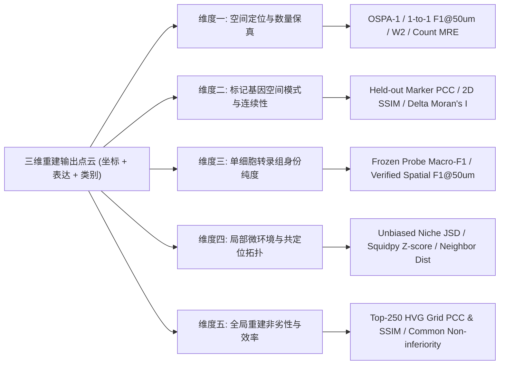
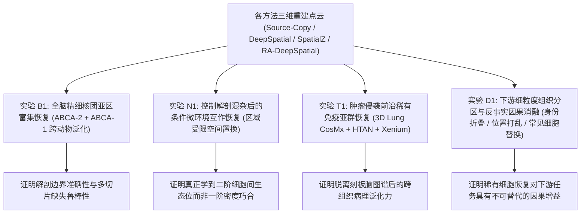

# 面向稀有细胞恢复的空间转录组学三维重建 —— 评价指标体系与下游实验设计

> **文档定位**：本文档面向 `RA_DeepSpatial`（Rare-cell-Aware DeepSpatial）项目及配套论文实验，结合近年空间转录组三维重建与单细胞空间映射代表性工作（*SpatialZ*, *DeepSpatial*, *SINTER3D*, *STADiffuser*, *STAGE*, *CytoSPACE*, *Cell2location*, *Tangram*, *scSpace*, *Squidpy* 等），制定一套**防刷分、无自证循环、文献出处明确**的五维定量评价指标体系，并给出四大**下游生物学验证与因果功能增量实验**的完整执行协议。  
> **关联文档**：模型架构与模块改造详见同目录下的 `稀有细胞三维重建_DeepSpatial改造方案.md`；现有评估器实现位于 `RA_DeepSpatial/raspatial/evaluation.py`。

---

## 一、任务特性、方法学边界与防刷分评价准则

### 1.1 任务本质：非配对三维单细胞点云重建 vs. 传统网格插值

在空间转录组连续切片三维重建任务中（如遮盖中间切片 $z_{\text{target}}$，由相邻可见切片 $z_{-}, z_{+}$ 恢复虚拟切片），生成对象并非像素对齐的二维图像网格，而是**非配对单细胞混合状态点云**：

$$\hat{\mathcal{S}} = \left\{ \left(\hat{\mathbf{x}}_i, \hat{\mathbf{g}}_i, \hat{c}_i\right) \right\}_{i=1}^{\hat{N}}, \quad \hat{\mathbf{x}}_i \in \mathbb{R}^2 \text{ (或 } \mathbb{R}^3\text{)}, \quad \hat{\mathbf{g}}_i \in \mathbb{R}^G, \quad \hat{c}_i \in \{1,\dots,C\}$$

由于生成细胞数 $\hat{N}$ 与真实切片细胞数 $N$ 不存在先验一一对应，且稀有亚类（占比 $\le 1\%$ 甚至 $\le 0.1\%$）在单张切片上往往仅有数个至数十个细胞，若直接沿用常规全局伪批量（Pseudobulk）相关系数或单向最近邻覆盖率，极易出现**指标虚高但生物学结构失真**的审稿漏洞。

### 1.2 四大核心防偏准则（Anti-Gaming Rules）

1. **防“过量撒点”刷高空间召回率（Over-generation Gaming）**  
   若模型将某稀有细胞生成数量放大 $3\text{--}5$ 倍并铺满目标脑区，单向最近邻召回率（Coverage Recall）会趋近 $1.0$。因此，任何位置评价必须强制采用**一对一二分图匹配（1-to-1 Bipartite Matching）**并同时捆绑**精确率（Precision）、基数惩罚距离（OSPA）与相对计数误差（Count MRE）**。
2. **防“相邻切片原样平移”刷高计数与全局分布（Source-Copy Gaming）**  
   由于连续切片间隔较近（如 $100\text{--}200\ \mu\text{m}$），直接复制最近可见切片（`Source-Copy`）即可获得极佳的细胞总数和伪批量均值相关性，但在解剖核团边界位移、出现/消失过渡层和局部微环境拓扑上会系统性失效。所有实验必须显式报告 `Source-Copy` 与纯线性最优传输插值（`UOT-Linear`）作为物理平凡下界。
3. **防“继承源标签与训练特征”自证循环（Label & Marker Circularity）**  
   - **标签独立性验证**：在 `RA_DeepSpatial` 的类型内局部最优传输（`local_uot`）设定下，轨迹两端类别相同（$c_0 \equiv c_1$），采样直接继承源细胞类别标签。因此，不能仅凭继承标签 $\hat{c}_i$ 宣称恢复了稀有细胞身份，必须引入**仅在可见切片上训练并冻结的纯基因表达分类器（Expression-only Reference Probe）**，独立检验生成表达向量 $\hat{\mathbf{g}}_i$ 是否真正具备该稀有亚类的转录组特征。
   - **标记基因留出机制**：由于模块 C（`MarkerTasks`）在训练损失中直接监督了部分已知 Marker，评估时必须严格区分参与训练的 `loss` Marker 与完全不参与训练的留出集 `heldout_C` Marker，以 `heldout_C` 指标作为核心泛化证据。
4. **防“匹配对幸存者偏差”与“极稀有硬阈值饱和”（Survivorship Bias & Cutoff Saturation）**  
   - 评估局部生态位时，若仅统计 $100\ \mu\text{m}$ 内配对成功的细胞对，会漏掉被错误投放到异位脑区的生成细胞（幸存者偏差），必须同时计算**某类型全体生成细胞 vs. 全体真实细胞的无偏聚合邻域组成散度**。
   - 对单切片仅 $2\text{--}5$ 个细胞的极稀有亚类（$\le 0.1\%$），$50/100\ \mu\text{m}$ 硬截断指标易饱和为 $0$，无法区分“同核团边缘微偏 $120\ \mu\text{m}$”与“跨脑区错放 $3000\ \mu\text{m}$”，需引入无截断的 **2-Wasserstein 距离（$W_2$）**。

### 1.3 细胞丰度分层与聚合统计准则

为彻底消除常见细胞对长尾信号的稀释，所有分类别指标均以**可见训练切片（Train Split）中的全局细胞频率 $p_c$** 锁定分层（严禁按测试切片动态重划）：

- **常见亚类（Common）**：$p_c > 1\%$
- **稀有亚类（Rare，主评测集）**：$0 < p_c \le 1\%$（如 `Zhuang-ABCA-2` 训练集共 338 个 `subclass` 中有 319 个属于 $\le 1\%$）
- **极稀有亚类（Ultra-rare，高难诊断集）**：$0 < p_c \le 0.1\%$

> **聚合铁律**：主表所有稀有类指标一律采用**按细胞亚类等权宏平均（Macro-average across rare subclasses）**，不得采用按细胞个数加权的微平均（Micro-average）。

---

## 二、文献支撑的五维分层评价指标体系

整个评价体系由五个正交维度构成，分别回答：**① 位置与数量准不准？② 标记基因空间纹理对不对？③ 生成的单细胞表达像不像真稀有细胞？④ 局部微环境邻居关系保没保留？⑤ 常见细胞与全局重建有没有受损？**

### 2.0 五维评价体系文献溯源总表

| 评估维度 | 代表性指标 | 对标参考文献与工具标准 | 解决的核心审稿关切 |
| :--- | :--- | :--- | :--- |
| **1. 空间定位与数量保真** | OSPA-1 ($\mu\text{m}$)、1-to-1 Spatial P/R/F1@$50\ \mu\text{m}$、Class $W_2$、Count MRE | *OSPA* (IEEE TSP 2008), *CytoSPACE* (Nat. Biotechnol. 2023), *DeepSpatial* (bioRxiv 2026), *STADiffuser* (Nat. Commun. 2026), *Cell2location* (Nat. Biotechnol. 2022) | 防止通过多生成细胞刷高召回率，量化微米级物理定位误差与丰度失配 |
| **2. 标记基因空间模式** | `heldout_C` Grid PCC/Spearman、2D Expression SSIM、$|\Delta \text{Moran's } I|$ | *SpatialZ* (Nat. Methods 2026), *SINTER3D* (Genome Biol. 2026), *STAGE* (Bioinformatics 2024), *Tangram* (Nat. Methods 2021), *Spateo* (Cell 2022) | 验证未参与训练损失的独立 Marker 是否恢复解剖条带、核团锐度与空间自相关 |
| **3. 单细胞转录组身份纯度** | Frozen Probe Macro-F1、**Verified Spatial F1@$50\ \mu\text{m}$**、Intra-type Cosine | *DeepSpatial* (bioRxiv 2026), *SpatialZ* (Nat. Methods 2026) | 破除源标签继承自证循环，检验生成基因表达向量在稀疏化前后是否保持亚类特异性 |
| **4. 局部微环境与共定位拓扑** | Unbiased Class Niche JSD、Squidpy 邻域富集 $Z$-score PCC、偏好邻居距离误差 | *SpatialZ* (Nat. Methods 2026), *scSpace* (Nat. Commun. 2023), *Squidpy* (Nat. Methods 2022) | 消除匹配对幸存者偏差，考核稀有细胞是否落入正确的局部细胞生态位 |
| **5. 全局非劣性与工程开销** | Top-250 HVG Grid PCC/SSIM、Common Count MRE、Global Pseudobulk PCC、VRAM/耗时 | *SpatialZ*, *SINTER3D*, *STADiffuser*, *DeepSpatial* | 证明稀有细胞增强机制未导致常见细胞精度退化或不可接受的算力膨胀 |

---

### 2.1 维度一：空间定位与细胞数量保真（Spatial Localization & Cardinality Fidelity）

设某目标切片上稀有亚类 $c$ 的真实细胞物理坐标集为 $X_c = \{\mathbf{x}_1, \dots, \mathbf{x}_m\} \subset \mathbb{R}^2$，重建细胞坐标集为 $\hat{X}_c = \{\hat{\mathbf{x}}_1, \dots, \hat{\mathbf{x}}_n\} \subset \mathbb{R}^2$（单位统一为微米 $\mu\text{m}$）。

#### 1. 最优子模式分配距离（OSPA-1 / Capped Hungarian Distance）$\downarrow$
- **文献依据**：Schuhmacher et al., *IEEE Transactions on Signal Processing* 2008（空间点过程金标准度量；对应现有代码 `hungarian_capped_mean_um`）。
- **数学定义**：令 $N_{\max} = \max(m, n)$，不妨设 $m \le n$（若 $m > n$ 则对称交换 $X_c, \hat{X}_c$），截断惩罚半径 $R_{\text{cap}} = 100\ \mu\text{m}$（约为 $5\text{--}8$ 个细胞体直径）：

$$d_{\text{OSPA}}^{(1)}\left(X_c, \hat{X}_c; R_{\text{cap}}\right) = \frac{1}{N_{\max}} \left( \min_{\pi \in \Pi_n} \sum_{i=1}^{m} \min\left(\|\mathbf{x}_i - \hat{\mathbf{x}}_{\pi(i)}\|_2, R_{\text{cap}}\right) + R_{\text{cap}} \cdot (n - m) \right)$$

  其中 $\Pi_n$ 为 $\{1,\dots,n\}$ 的排列集合，通过匈牙利算法（或带虚拟节点的稀疏最小权二分图匹配）精确求解。当 $m = n = 0$ 时不计入该切片均值；当仅一侧为空（$m=0, n>0$ 或 $m>0, n=0$）时，距离记为满额惩罚 $R_{\text{cap}}$。
- **核心价值**：将**定位几何误差**与**少生/多生的数量惩罚**严密统一在同一物理量纲（$\mu\text{m}$）下，任何漏生或幻觉多生一个细胞都会直接付出 $100\ \mu\text{m}$ 代价。

#### 2. 一对一二分图空间匹配精确率 / 召回率 / F1（1-to-1 Spatial P / R / F1 @ $r$）$\uparrow$
- **文献依据**：*CytoSPACE* (Vahid et al., *Nature Biotechnology* 2023) 单细胞定位评测准则（对应代码 `match_precision_50um`、`match_recall_50um`、`match_f1_50um`）。
- **数学定义**：构建二分图 $G = (X_c, \hat{X}_c, E_r)$，仅当 $\|\mathbf{x}_i - \hat{\mathbf{x}}_j\|_2 \le r$（主报告 $r = 50\ \mu\text{m}$，辅报告 $r = 100\ \mu\text{m}$）时连边，求解最大基数（且同基数下最小距离和）一对一匹配集 $M_r^*$：

$$\text{Prec}_c(r) = \frac{|M_r^*|}{n}, \quad \text{Rec}_c(r) = \frac{|M_r^*|}{m}, \quad \text{F1}_c(r) = \frac{2|M_r^*|}{m + n}$$

- **规范说明**：主表必须报告 **1-to-1 Spatial F1@$50\ \mu\text{m}$**；允许一对多重复命中的 `Coverage Recall/Precision` 仅留作诊断附表，避免多个真实细胞共享同一个生成细胞造成虚高。

#### 3. 类型条件无截断 2-Wasserstein 距离（Class-conditional $W_2$ / Sliced $W_2$）$\downarrow$
- **文献依据**：*DeepSpatial* (*bioRxiv* 2026)、*STADiffuser* (*Nature Communications* 2026)、*PASTE* (*Nature Methods* 2022)。
- **数学定义**：对 $m > 0$ 且 $n > 0$ 的同类型均匀经验测度 $\mu_c = \frac{1}{m}\sum_{i=1}^m \delta_{\mathbf{x}_i}$ 与 $\hat{\mu}_c = \frac{1}{n}\sum_{j=1}^n \delta_{\hat{\mathbf{x}}_j}$：

$$W_2(\mu_c, \hat{\mu}_c) = \left( \min_{\Gamma \in \Pi(\mu_c, \hat{\mu}_c)} \sum_{i=1}^m \sum_{j=1}^n \Gamma_{ij} \|\mathbf{x}_i - \hat{\mathbf{x}}_j\|_2^2 \right)^{1/2}$$

- **核心价值**：专门服务于**极稀有亚类（$\le 0.1\%$）**。当生成点偏离真实核团中心 $120\ \mu\text{m}$ 时，F1@$50\ \mu\text{m}$ 与 OSPA@$100\ \mu\text{m}$ 均已触顶饱和，唯有 $W_2$ 能连续反映宏观脑区收敛质量。

#### 4. 丰度相对误差（Count MRE $\downarrow$）、类型缺失率（Missing Rate $\downarrow$）与假阳性类型数（False-Presence $\downarrow$）
- **数学定义**：
  - 对真实存在（$m_c > 0$）的类型：$\text{MRE}_c = \frac{|n_c - m_c|}{m_c}$；同时记录截断上限版 $\min(\text{MRE}_c, 2.0)$ 以防单细胞极端异常值主导均值，但必须同步原样报告未截断中位数与均值。
  - **Missing-Type Rate**：真实切片中 $m_c > 0$ 的稀有亚类里，重建计数 $n_c = 0$ 的比例。
  - **False-Presence Count**：真实切片中 $m_c = 0$（该解剖层面本不该出现该核团亚型），但重建错误生成 $n_c > 0$ 的类型数。

---

### 2.2 维度二：标记基因空间模式与自相关结构保真（Marker Spatial Pattern & Continuity）

将切片物理平面划分为边长 $\Delta = 100\ \mu\text{m}$（高分辨率局部核团分析可取 $\Delta = 50\ \mu\text{m}$）的规则二维网格，在非空组织掩膜 $\Omega$ 上构建真实与重建的二维空间基因表达张量 $Y_g, \hat{Y}_g \in \mathbb{R}^{H \times W}$（网格内 `log1p` 表达均值或总和）。

> **防泄漏红线**：所有 Marker 指标必须拆分为两栏独立汇报：
> - **`loss` Markers**：参与了模块 C 训练监督的标记基因（检验优化有效性）；
> - **`heldout_C` Markers（主表采用）**：从外部权威图谱（如 Yao et al., *Nature* 2023 表 S7）确定性抽离、训练全程不可见的标记基因（检验真实生物学泛化）。

#### 1. 网格化标记基因空间相关性（Grid Spatial PCC & Spearman $\rho$）$\uparrow$
- **文献依据**：*Tangram* (*Nature Methods* 2021)、*SpatialZ* (*Nature Methods* 2026)、*STAGE* (*Bioinformatics* 2024)。
- **定义**：在有效组织网格集合 $\Omega$ 上计算平坦化向量 $Y_g(\Omega)$ 与 $\hat{Y}_g(\Omega)$ 的皮尔逊相关系数（PCC，衡量线性幅值）与斯皮尔曼秩相关（Spearman $\rho$，对稀疏零膨胀与局部极值更稳健）。

#### 2. 二维基因表达结构相似性（2D Expression SSIM）$\uparrow$
- **文献依据**：*STAGE* (*Bioinformatics* 2024)、*SINTER3D* (*Genome Biology* 2026)、*SpatialZ* (*Nature Methods* 2026)。
- **数学定义**：将 $Y_g, \hat{Y}_g$ 按真实切片动态范围归一化至 $[0, 1]$，采用滑动高斯窗口（或全局窗口）计算亮度、对比度与结构协方差：

$$\text{SSIM}(Y_g, \hat{Y}_g) = \frac{(2\mu_Y \mu_{\hat{Y}} + C_1)(2\sigma_{Y\hat{Y}} + C_2)}{(\mu_Y^2 + \mu_{\hat{Y}}^2 + C_1)(\sigma_Y^2 + \sigma_{\hat{Y}}^2 + C_2)}$$

- **核心价值**：PCC 对背景大面积零值敏感而对局部解剖边界模糊不敏感；SSIM 能精准惩罚皮层分层条带模糊或核团边缘弥散。

#### 3. 空间自相关保真度（$|\Delta \text{Moran's } I| \downarrow$ 与跨基因自相关排序相关 $\uparrow$）
- **文献依据**：*SpatialZ* (*Nature Methods* 2026)、*SINTER3D* (*Genome Biology* 2026)、*Spateo* (*Cell* 2022)、*Squidpy* (*Nature Methods* 2022)。
- **数学定义**：构建网格空间邻接权重矩阵 $W = [w_{uv}]$（8-邻域或径向高斯核），计算基因 $g$ 的莫兰指数：

$$I(Y_g) = \frac{|\Omega|}{\sum_{u,v} w_{uv}} \frac{\sum_{u,v} w_{uv}(Y_{g,u} - \bar{Y}_g)(Y_{g,v} - \bar{Y}_g)}{\sum_{u} (Y_{g,u} - \bar{Y}_g)^2}$$

  定义空间自相关绝对偏差：

$$\Delta I_g = \left| I(\hat{Y}_g) - I(Y_g) \right| \downarrow$$

  并同步报告 Geary's $C$ 绝对偏差 $|\Delta C_g| \downarrow$ 以及跨全部稀有 Marker 的 $\text{Spearman}\left(\{I(Y_g)\}, \{I(\hat{Y}_g)\}\right) \uparrow$。
- **审稿警示**：**切勿将 $I(\hat{Y}_g)$ 本身越大当作越好**——过度平滑的回归模型会产生异常高的虚假空间自相关，唯有与真实切片自相关结构一致（$\Delta I_g \to 0$）才是高保真重建。

---

### 2.3 维度三：单细胞转录组身份纯度（Transcriptomic Identity Purity）

#### 1. 冻结纯表达参考分类器探针（Frozen Expression Probe Macro-F1 & Concordance）$\uparrow$
- **文献依据**：*DeepSpatial* (*bioRxiv* 2026)、*SpatialZ* (*Nature Methods* 2026)。
- **评估协议**：
  1. 仅使用**可见训练切片（Train Split）**的真实单细胞基因表达向量 $\mathbf{g}$（严禁输入空间坐标 $(x,y,z)$、邻域特征或测试切片数据），训练一个标准多层感知机（2 层 MLP）或正则化多分类 Logistic 探针 $f_{\text{probe}}: \mathbb{R}^G \to \{1,\dots,C\}$，训练后彻底冻结权重。
  2. 对重建切片中的生成细胞 $(\hat{\mathbf{x}}_j, \hat{\mathbf{g}}_j, \hat{c}_j)$，令 $\tilde{c}_j = f_{\text{probe}}(\hat{\mathbf{g}}_j)$，计算稀有亚类上的 **Probe Concordance**（$\mathbb{P}(\tilde{c}_j = \hat{c}_j \mid \hat{c}_j = c)$ 的宏平均）与 **Rare Probe Macro-F1**。
  3. **双阶段检验**：分别在模块后处理 `enforce_panel_sparsity`（按类型目标非零基因数做 top-$k$ 截断）**之前与之后**运行该探针，证明表达身份保真源自流匹配生成本身，而非后处理掩码修饰。

#### 2. 身份验证型空间一对一匹配（Expression-Verified 1-to-1 Spatial F1 @ $50\ \mu\text{m}$）$\uparrow$
- **设计动机（论文黄金复合指标）**：在维度一的二分图匹配基础上增加转录组身份门控——仅当真实细胞 $(\mathbf{x}_i, c_i)$ 与生成细胞 $(\hat{\mathbf{x}}_j, \hat{\mathbf{g}}_j, \hat{c}_j)$ 同时满足：
  1. 继承类别一致：$\hat{c}_j = c_i$；
  2. 物理欧氏距离达标：$\|\mathbf{x}_i - \hat{\mathbf{x}}_j\|_2 \le 50\ \mu\text{m}$；
  3. **纯表达独立验真通过**：$f_{\text{probe}}(\hat{\mathbf{g}}_j) = c_i$（或位于真实类 top-3 置信区间，主指标采用严格 top-1 一致）；
  才允许在二分图中连边并计入匹配集 $M_{\text{ver}}^*$。
- **科学意义**：用一个不可作弊的单一指标同时锁死“**位置准 + 数量准 + 基因表达真**”，彻底回应审稿人关于标签继承（$c_0 \equiv c_1$）公平性的质疑。

#### 3. 同类型伪批量余弦相似度（Intra-type Cosine $\uparrow$）与标记基因富集误差（Marker Enrichment Error $\downarrow$）
- **Intra-type Cosine**：计算类型 $c$ 内生成细胞平均表达向量 $\bar{\hat{\mathbf{g}}}_c$ 与真实细胞平均表达向量 $\bar{\mathbf{g}}_c$ 的余弦相似度（对应代码 `type_expr_cosine`）。
- **Marker Enrichment Error**：记类型 $c$ 内部与外部细胞的 `heldout_C` 标记基因均值差为 $\Delta \mu_c = \mu_{\text{in}}(c) - \mu_{\text{out}}(c)$，考核 $|\Delta \hat{\mu}_c - \Delta \mu_c| \downarrow$，衡量稀有细胞相对于周围背景细胞的分子信噪比是否坍缩。

---

### 2.4 维度四：局部微环境与细胞共定位拓扑（Microenvironment & Niche Architecture）

#### 1. 无偏全集聚合邻域组成散度（Unbiased Class-Aggregated Niche JSD）$\downarrow$
- **文献依据**：*SpatialZ* (*Nature Methods* 2026) 微环境组成分析、*scSpace* (*Nature Communications* 2023)（升级现有 `evaluation.py` 中仅针对匹配成功点对计算 `local_composition_js` 的实现）。
- **数学定义**：对某稀有亚类 $c$ 的**全部**真实细胞 $\mathbf{x}_i \in X_c$，统计其半径 $r_{\text{niche}} = 50\ \mu\text{m}$（或 $k=15$ 近邻，排除自身）内的邻居细胞类型经验分布 $\mathbf{p}_i \in \Delta^{C-1}$，求类内均值分布 $\bar{\mathbf{p}}_c = \frac{1}{|X_c|}\sum_{i \in X_c} \mathbf{p}_i$；同理对**全部**生成细胞 $\hat{\mathbf{x}}_j \in \hat{X}_c$（包含未匹配和放错位置的点，邻居在全体生成点云 $\hat{\mathcal{S}}$ 中检索）求得 $\bar{\hat{\mathbf{p}}}_c$，计算 Jensen–Shannon 散度：

$$\text{JSD}_{\text{unbiased}}(c) = \frac{1}{2}\text{KL}\left(\bar{\mathbf{p}}_c \,\middle\|\, \mathbf{m}_c\right) + \frac{1}{2}\text{KL}\left(\bar{\hat{\mathbf{p}}}_c \,\middle\|\, \mathbf{m}_c\right), \quad \mathbf{m}_c = \frac{1}{2}(\bar{\mathbf{p}}_c + \bar{\hat{\mathbf{p}}}_c)$$

- **配套诊断**：主表报告 $\text{JSD}_{\text{unbiased}} \downarrow$（惩罚异位乱放导致的微环境违和）；附表同步保留已配对点对的 $\text{JSD}_{\text{matched}} \downarrow$（剥离大尺度位移后评估纯局部邻域组配质量）。

#### 2. 空间置换邻域富集矩阵一致性（Squidpy Neighborhood Enrichment $Z$-score Concordance）$\uparrow$
- **文献依据**：Palla et al., *Squidpy* (*Nature Methods* 2022, `sq.gr.nhood_enrichment`)、*SpatialZ* (*Nature Methods* 2026)。
- **计算方式**：分别在真实切片与重建切片构建空间 Delaunay / $r$-近邻图，经 $B = 1000$ 次细胞标签置换（在精细核团分析中采用区域内受限置换）得到类型对 $(c, c')$ 的标准化邻域共现矩阵 $Z^{\text{true}}, Z^{\text{pred}} \in \mathbb{R}^{C \times C}$。提取至少一端为稀有亚类的矩阵子块，计算：
  - **Enrichment $Z$-score PCC / Spearman** $\uparrow$；
  - **显著互作符号一致率（Top Interaction Sign Concordance / F1）** $\uparrow$（针对 $|Z^{\text{true}}_{c,c'}| > 2$ 的真实吸引/排斥细胞对）。

#### 3. 偏好邻居物理距离误差（Preferred-Neighbor Distance Error, $\mu\text{m}$）$\downarrow$
- **定义**：由可见训练切片预定义每个稀有亚类 $c$ 在 $50\ \mu\text{m}$ 内共现频率最高的 Top-1 偏好伴侣类型 $c^*(c)$（完全不触碰测试集），在测试切片上计算稀有细胞到最近一个 $c^*(c)$ 细胞的中位物理距离偏差 $|\text{med}(d_{\text{pred}}) - \text{med}(d_{\text{true}})| \downarrow$（对应代码 `preferred_neighbor_dist_error_um`）。

---

### 2.5 维度五：全局重建非劣性与工程开销（Global Non-Inferiority & Efficiency）

稀有细胞增强机制（重加权采样、双端生态位编码、Marker 辅助头）成立的前提是**不牺牲常见细胞（$>1\%$）与全切片整体转录组场的质量**。

1. **空间显式全局保真度（Top-250 HVG 2D Grid PCC / SSIM / RMSE）**：在二维规则网格（$100\ \mu\text{m}$）上评估全切片前 250 个高变基因（HVGs）的空间相关性与 SSIM。相比对空间错位完全失明的“全切片均值 Pseudobulk PCC（常年 $>0.99$ 无区分度）”，网格化 HVG 指标才是真正的全局非劣性护栏。
2. **常见细胞定位与丰度非劣性（Common Subclass $>1\%$ OSPA-1 & Count MRE）**：按相同公式单独汇总常见亚类指标。
3. **预声明非劣性判据（Pre-declared Non-inferiority Margin）**：在主实验统计检验中预先设定容忍界 $\epsilon$（例如：相对于原版 `DeepSpatial`，Top-250 HVG Grid PCC 下降不超过 $\epsilon_{\text{PCC}} = 0.005$，Common OSPA-1 退化不超过 $\epsilon_{\text{OSPA}} = 1.5\ \mu\text{m}$，且全切片 Pseudobulk `log1p` MSE 不发生显著劣化）。
4. **计算开销透明披露**：统一记录相同 GPU 硬件下的训练总时长（wall-clock hours）、单张虚拟切片推理采样耗时（seconds/slice）、峰值显存（Peak VRAM, GB）以及 UOT 预计算缓存体积。

---

## 三、论文实验表格编排与四级基线对照规范

### 3.1 强制纳入的四级基线对照矩阵（Baseline Hierarchy）

| 基线层级 | 方法名称 | 核心机制与对照角色 | 适用指标范围 |
| :--- | :--- | :--- | :--- |
| **Level 0：物理平凡下界** | `Sparse-Observed` | 不做三维插值，仅用可见切片直接参与下游分区/统计 | 下游实验 B1 / T1 / D1 |
| | `Source-Copy` | 直接将最近邻可见切片（或前后切片各半随机抽样）原样平移至目标 $z$ | 全部五个维度 + 全部下游实验（检验是否真学到跨层几何形变） |
| | `UOT-Linear` | 仅用非平衡最优传输配对做线性坐标与表达插值，无神经网络流修正 | 全部五个维度（剥离最优传输本身的贡献） |
| **Level 1：同架构基准** | `DeepSpatial` (`baseline`) | 原版全局 UOT + 均匀抽样 + 按细胞等权 CFM 主干 | 核心对比基准 |
| | `DeepSpatial-Control` (`control`) | 匹配模块 B 额外隐藏层参数量，但关闭稀有采样、UOT 约束与生态位/Marker 输入 | 严格排除“性能提升仅来自模型参数量增加”的审稿质疑 |
| **Level 2：外部三维重建 SOTA** | `SpatialZ` (*Nat. Methods* 2026) | 基于邻域配对传递与条件生成的连续虚拟切片三维重建方法 | 全部五个维度 + 全部下游实验 |
| | `SINTER3D` / `STADiffuser` (2026) | 最新生成式三维空间转录组插值/扩散重建基线 | 全部五个维度（若模型仅输出网格表达如 `STAGE`，则仅对比维度二与维度五） |
| **Level 3：内部消融矩阵** | `R0` / `no_A` / `no_B` / `no_C` / `no_D` / `Full` | 系统拆解模块 A（类型感知传输与稀有重采样）、B（双端生态位条件）、C（Marker 一致性）、D（计数先验与稀疏校准）的独立与协同增益 | 消融实验表（Table 2） |

### 3.2 论文正文主表（Table 1）正交核心指标布局

为避免主表指标冗余，推荐精选 **6 个覆盖全部维度的正交核心指标**作为正文 Table 1 列头（对其余诊断指标归入 Supplementary Tables S1–S4）：

| 方法 | [定位+计数] Rare OSPA-1 ($\mu\text{m}$) $\downarrow$ | [定位+身份] Verified Spatial F1@$50\mu\text{m}$ $\uparrow$ | [数量保真] Rare Count MRE $\downarrow$ | [泛化表达] `heldout_C` Marker PCC / SSIM $\uparrow$ | [微环境] Unbiased Niche JSD $\downarrow$ | [全局护栏] Top-250 HVG Grid PCC / Common OSPA-1 |
| :--- | :---: | :---: | :---: | :---: | :---: | :---: |
| `Source-Copy` | ... | ... | ... | ... | ... | ... |
| `UOT-Linear` | ... | ... | ... | ... | ... | ... |
| `DeepSpatial` | ... | ... | ... | ... | ... | ... |
| `DeepSpatial-Control` | ... | ... | ... | ... | ... | ... |
| `SpatialZ` | ... | ... | ... | ... | ... | ... |
| **`RA-DeepSpatial (Ours)`** | **Best** | **Best** | **Best** | **Best** | **Best** | **Non-inferior** |

- **附表 S1（丰度分层细化表）**：按 `Rare (0.1% < p <= 1%)`、`Ultra-rare (p <= 0.1%)`、`Common (p > 1%)` 三档展开 1-to-1 P/R/F1@$50/100\ \mu\text{m}$、$W_2$、Missing Rate 与 False-Presence。
- **附表 S2（转录组与 Marker 深度诊断表）**：对比 `loss` vs. `heldout_C` Marker PCC/Spearman/$|\Delta \text{Moran's } I|$，以及 top-$k$ 稀疏化前后的 Frozen Probe Macro-F1。
- **附表 S3（微环境互作诊断表）**：对比 Unbiased Niche JSD vs. Matched-Pair JSD、Squidpy 置换 $Z$-score PCC 与偏好邻居物理距离误差。
- **附表 S4（模块消融与超参敏感性表）**：完整汇报 `baseline`, `control`, `R0`, `no_A`, `no_B`, `no_C`, `no_D`, `Full` 及抽样幂次 $\alpha$、邻域半径 $r$、Marker 权重敏感性。

---

## 四、下游生物学验证与功能增量实验分析

高水平方法学论文不仅需要证明“重建指标数值更好”，更必须回答两个核心生物学问题：
1. **生物学发现保真（Biological Discovery Fidelity）**：在盲测缺失层中，重建点云能否还原真实解剖亚核团富集、条件细胞互作生态位，并泛化到无刻板对称解剖结构的实体肿瘤微环境？
2. **下游分析因果增量（Downstream Causal Utility）**：恢复这不到 $1\%$ 的稀有细胞，对下游精细组织分区和病理生态位识别究竟带来了多少不可替代的信息增量？

以下设计四个递进式下游实验（**实验 B1 → N1 → T1 → D1**），所有数据集与候选亚群均已与项目本地数据资产对齐。

---

### 4.1 下游实验一（B1）：小鼠全脑精细解剖核团与亚区特异性富集恢复

#### 1. 科学问题与实验定位
脑内诸多关键神经调质与内分泌神经元亚群（如组胺能神经元、特定下丘脑神经肽亚群）在全脑占比不足 $0.05\%$，但在三维空间上严格局限于百微米尺度的单一解剖亚核团。原版全局流匹配极易将其淹没为周围高丰度兴奋性/抑制性神经元，或弥散泄漏至邻近核团。本实验检验模型在未见切片（及连续多切片缺失）中精确重建亚核团分子边界的能力。

#### 2. 数据集配置与跨个体泛化协议
- **主开发与内部盲测集（`Zhuang-ABCA-2`）**：66 张连续冠状 MERFISH 切片（1,227,408 细胞，1,122 基因，338 个 `subclass`），沿用固定切分（58 train / 3 val: `sec_015, sec_034, sec_059` / 5 test: `sec_008, sec_022, sec_040, sec_053, sec_066`），结合 `data/ccf-ABCA-2.csv`（已覆盖 86.08% 真实细胞的 Allen CCFv3 三维坐标与 `parcellation_index`）及 Allen CCFv3 标准解剖层级映射表。
- **独立生物学个体泛化验证（`Zhuang-ABCA-1`，强制外部验证）**：另一独立小鼠个体的 147 张冠状 MERFISH 切片（同 1,122 基因面板，`data/download/download-ABCA-1.ipynb`）。可在 `ABCA-1` 上执行同等隔层遮盖盲测（以及跨动物预训练/零样本迁移测试），将证据等级从“单只小鼠内部切片插值”提升至**跨动物个体可重复发现**。
- **可选跨切面/跨基因面板扩展**：`Zhuang-ABCA-3`（矢状面切片，检验切片方向不变性）或 Allen `MERFISH-C57BL6J-638850`（500 基因面板，检验面板缩减鲁棒性）。

#### 3. 虚拟细胞的无泄漏 Allen CCF 解剖投射协议
生成的虚拟细胞没有真实 `cell_label`，无法直接查表获取 CCF 分区。为杜绝数据泄漏：
1. **严禁使用目标测试切片自身的真实细胞构建分区器**；
2. 仅利用**前后相邻可见训练切片**中带有有效 Allen CCF 标签的真实细胞，拟合三维薄板样条空间变换场（Thin-Plate Spline, TPS）或距离加权 $k$-NN 体素分类器 $g_{\text{CCF}}: (x, y, z) \mapsto \text{CCF Subregion}$；
3. 先在被遮盖测试切片的真实细胞坐标上验证 $g_{\text{CCF}}$ 的解剖亚区投射准确率（作为映射器自身误差基线），再用完全相同的 $g_{\text{CCF}}$ 为所有对比方法的生成细胞赋予解剖亚区标签。

#### 4. 锁定验证靶点与同核团近邻对照（基于本地数据实测筛选）
1. **主验证靶点：`092 TMv-PMv Tbx3 Hist-Gaba`（下丘脑结节乳头体腹侧核/乳头体前腹侧核组胺能-GABA 能神经元）**
   - *丰度与分布特性*：`ABCA-2` 全脑仅 **130 个细胞**（全局占比 $\approx 0.011\%$），严格富集于下丘脑后部连续 7 张切片（`sec_039`: 12, **`sec_040`: 31 [恰好位于标准测试集!]**, `sec_041`: 34, `sec_042`: 39, `sec_044`: 9, `sec_045`: 4, `sec_046`: 1），其余 59 张切片全为 0。
   - *面板核心标志物*：`Hdc`（组胺脱羧酶，经典组胺能唯一合成酶）、`Tbx3`、`Gad2`、`Slc32a1`。
2. **次验证与同核团亚区辨析对：`128 VMH Fezf1 Glut` vs. `129 VMH Nr5a1 Glut`**
   - *对照设计*：`128 VMH Fezf1 Glut` 为腹内侧下丘脑（VMH）稀有兴奋性亚群（全脑 **86 个细胞**，标志物 `Fezf1`, `Slc17a6`），而 `129 VMH Nr5a1 Glut` 为同属 VMH 的常见近邻亚群（**950 个细胞**）。通过对比两者在 VMH 内部腹外侧（VMHvl）与背内侧（VMHdm）的精细空间分离度，证明模型并未把稀有 `Fezf1` 亚群简单混同于同核团常见 `Nr5a1` 神经元。
3. **探索性极稀有灵敏度边界靶点**：`091 ARH-PVi Six6 Dopa-Gaba`（弓状核多巴胺能-GABA 能神经元，55 细胞）与 `142 HY Gnrh1 Glut`（促性腺激素释放激素神经元，25 细胞，用于展示极低计数离散情形下的恢复边界与置信区间）。

#### 5. 定量评价终点与跨间距压力测试
- **核团相对富集倍数误差（Subregion Log-Fold-Enrichment MAE $\downarrow$）**：以父系神经递质大类（如全体下丘脑 GABA 能或 Glut 能神经元）作为分母消除整体细胞密度波动，定义亚型 $c$ 在目标核团 $R^*$ 相对脑区背景 $\bar{R}$ 的对数富集比：

$$\text{LFE}(c, R^*) = \log_2 \left( \frac{\big(N_{c, R^*} + \epsilon_0\big) / \big(N_{\text{parent}, R^*} + \epsilon_0\big)}{\big(N_{c, \bar{R}} + \epsilon_0\big) / \big(N_{\text{parent}, \bar{R}} + \epsilon_0\big)} \right)$$

  考核 $|\widehat{\text{LFE}} - \text{LFE}_{\text{true}}| \downarrow$。
- **全脑解剖核团存在性检测 AUPRC $\uparrow$**（对齐 *Cell2location* 区域定位标准）：在全部候选解剖亚区上评估稀有亚群密度预测识别真实驻留核团的精确率—召回率曲线下面积。
- **核团外假阳性溢出率（Out-of-ROI Spillover Rate $\downarrow$）**：生成细胞落入目标核团（含 $50\ \mu\text{m}$ 边界配准缓冲带）之外的异常比例 $\frac{N_{c, \notin R^*_{\text{buf}}}}{\hat{N}_c}$。
- **多切片连续缺失压力测试（Multi-slice Gap Stress Test）**：在靶点核心区间固定评估切片（如 `sec_040`），对比遮盖单张（Gap $= 1$，间隔 $\sim 200\ \mu\text{m}$）、连续遮盖 2 张（Gap $= 2$，`sec_040`–`sec_041`，间隔 $\sim 400\ \mu\text{m}$）与连续遮盖 3 张（Gap $= 3$，`sec_040`–`sec_042`，间隔 $\sim 600\ \mu\text{m}$）时各方法核团富集误差与 Verified F1 的衰减斜率。

---

### 4.2 下游实验二（N1）：控制解剖共定位混杂后的条件微环境互作恢复

#### 1. 科学问题（剥离一阶区域混杂 vs. 二阶细胞互作）
在空间组学分析中，两种细胞在全脑尺度呈现高共现，往往仅仅因为它们共同居住在同一个解剖核团（一阶宏观密度混杂），而非在微米级细胞邻域内存在真实的旁分泌、突触或胶质支持关系（二阶局部微环境互作）。本实验旨在证明：模块 B（双端局部生态位编码）能够真正恢复**控制解剖背景后的条件细胞间共定位关系**。

#### 2. 统计零模型与条件共现建模协议
1. **严禁使用全切片无约束随机打乱（Naive Whole-slice Permutation）**，因为全切片打乱会把皮层细胞换到下丘脑，导致任何下丘脑内部细胞对的 $Z$-score 都极其显著。
2. **区域与密度双受限置换检验（Region- & Density-Constrained Spatial Permutation）**：仅在**同一个 Allen CCF 解剖亚核团内部**（且按局部细胞总密度分位数分桶），对细胞亚类标签执行 $B = 1000$ 次受限随机置换，构建零分布。
3. **条件对数互作效应量 $\theta_{A,B}$**：对目标稀有亚群 $A$ 与候选微环境伴侣 $B$（如局部血管内皮/周细胞、室管膜伸展细胞 Tanycytes、特定星形胶质亚型或局部中间神经元），在核团内部拟合控制局部总细胞密度与距核团中心距离的条件逻辑模型或受限共现比，提取条件对数优势比 $\theta_{A,B}$。

#### 3. 定量评价终点
- **条件互作效应绝对误差**：$|\hat{\theta}_{A,B}^{\text{pred}} - \theta_{A,B}^{\text{true}}| \downarrow$（在真实存在正/负微环境偏好的候选对上宏平均）。
- **多尺度径向跨类型共现曲线积分误差（Radial Cross-Co-occurrence Curve IAE $\downarrow$）**：在 $r \in [15, 200]\ \mu\text{m}$ 范围内以 $10\ \mu\text{m}$ 为步长计算受限双变量 Ripley's Cross-$L_{A,B}(r)$（或条件共现概率比曲线 $g_{A,B}(r)$），统计曲线积分绝对误差：

$$\text{IAE}_{A,B} = \frac{1}{r_{\max} - r_{\min}} \int_{r_{\min}}^{r_{\max}} \left| \hat{L}_{A,B}(r) - L_{A,B}^{\text{true}}(r) \right| dr$$

- **真实微环境伴侣发现 F1（Conditional Niche Partner Discovery F1 $\uparrow$）**：以测试切片真实数据在 BH-FDR $q < 0.05$ 下检出的显著近程吸引/排斥伴侣集为金标准，评估各重建方法的检出精确率与召回率。

---

### 4.3 下游实验三（T1）：跨组织与病理泛化——肿瘤侵袭前沿稀有免疫亚群恢复

#### 1. 科学问题与审稿战略价值
正常成年小鼠脑具有高度保守、左右对称的解剖蓝图，审稿人常质疑模型只是“记住了固定脑坐标模板”。将评估拓展至**无固定解剖模板、形态高度异质的实体肿瘤三维切片**，聚焦**肿瘤—基质侵袭前沿（Tumor–Stroma Invasive Margin）**处占比极低但决定免疫治疗响应的关键免疫亚群（如 `FOXP3+ Treg`、交叉呈递树突状细胞 `cDC1 / LAMP3+ mregDC`、组织驻留肥大细胞 `Mast cells`），是证明方法普适性的最强证据。

#### 2. 多模态肿瘤数据集梯队与分辨率严谨适配
针对不同空间组学技术分辨率（单细胞成像 vs. 多细胞 Spot 测序），分两个层级严谨推进，绝不混淆单细胞生成与 Spot 反卷积：

1. **Tier 1 —— 单细胞级三维肿瘤主基准（零架构修改，直接验证核心模型）**
   - **推荐数据集**：**3D 人肺癌单细胞空间图谱（Pentimalli et al., *Cell Systems* 2025, NanoString CosMx SMI）**——包含间隔 $30\ \mu\text{m}$ 的 6 张连续三维肺肿瘤单细胞切片（共 340,644 个单细胞，1,000 基因面板，含完整肿瘤上皮、基质及细粒度免疫注释）。
   - **适配优势**：数据形态与 MERFISH 完全同构（真实单细胞坐标 + 离散细胞类型 + 靶向千基因面板），可直接运行单细胞版 `RA_DeepSpatial` 执行隔层遮盖三维重建（如遮盖第 2、4 或 3、5 层），评估肿瘤表面侵袭带（Tumor Surface Niche）中稀有 `Regulatory T cells`、`Dendritic cells` 与 `Mast cells` 的三维恢复。
2. **Tier 2 —— 多患者三维病理队列扩展与同组织单细胞正交锚定**
   - **三维多标本队列（HTAN WUSTL, Mo et al., *Nature* 2024）**：乳腺原发癌（如 `HT206B1`）与肝转移瘤（如 `HT268B1`）连续三维 10x Visium 切片块。
     > **分辨率适配规范**：10x Visium 为 $55\ \mu\text{m}$ 多细胞混合 Spot，**严禁强行赋单细胞 one-hot 硬标签**。在此分支上，需先利用配对 snRNA-seq 参考集运行 `Cell2location` 或 `RCTD` 获取每个 Spot 的亚群软丰度向量 $\mathbf{w}_i \in \mathbb{R}_+^C$，将 `RA_DeepSpatial` 的传输代价与抽样权重平滑推广至软组成距离（Soft-composition UOT），专门检验多患者三维肿瘤块中“稀有免疫富集微区（Rare-immune Enriched Spots）”的跨层恢复。
   - **正交单细胞金标准锚定（本地已有 `data/Breast-GSE243280/h5ad/`）**：利用人乳腺导管原位癌/浸润癌同组织块连续切片 **10x Xenium（单细胞级）+ Visium 配对数据（`GSE243280`, Janesick et al., *Nature Communications* 2023）**（及可选结直肠癌 Visium HD + Xenium `GSE280318`），直接以单细胞 Xenium 切片验证侵袭导管边缘稀有免疫/肌上皮边界亚群的空间梯度真实性。

#### 3. 无泄漏侵袭边界构建与定量评价终点
- **无泄漏边界距离场构建**：目标遮盖切片上的肿瘤—基质侵袭界面 $\mathcal{B}_0$（有符号距离 $d = 0$，$d < 0$ 指向肿瘤实质内部，$d > 0$ 指向外周基质）必须由**上下相邻可见切片的肿瘤边界经三维曲面插值**（或由配对 H&E 组织学图像独立分割）确定，**严禁使用各方法自己生成的转录组反推边界**，以保证所有对比方法共享完全一致的物理标尺 $d(\mathbf{x})$。
- **四大定量终点**：
  1. **侵袭界面距离—丰度曲线积分绝对误差（Signed-Distance Profile IAE $\downarrow$）**：在 $d \in [-300, +300]\ \mu\text{m}$（分箱宽度 $25\ \mu\text{m}$）上统计稀有免疫亚群相对丰度曲线 $f(d)$：

$$\text{Profile-IAE} = \frac{1}{600} \int_{-300}^{+300} \left| \hat{f}(d) - f_{\text{true}}(d) \right| dd$$

  2. **富集峰值位移误差（Interface Peak Shift $|\Delta d_{\text{peak}}|\ \mu\text{m} \downarrow$）**：衡量模型是否正确捕捉到稀有免疫细胞紧贴侵袭前沿（通常 $|d| \le 75\ \mu\text{m}$）聚集的峰值位置，而非将其推入坏死核心或远端基质。
  3. **侵袭前沿稀有免疫热点识别 AUPRC $\uparrow$**：将真实切片中稀有免疫密度前 $5\%$ 的局部微区定义为免疫调控热点（Hotspots），计算各重建密度场识别真实热点的 AUPRC。
  4. **父系免疫谱系内局部比例散度（Local Intra-lineage Ratio JSD $\downarrow$）**：控制总淋巴细胞/髓系浸润量混杂，专门计算侵袭带内局部 `Treg / Total T`、`cDC1 / Total Myeloid` 比率空间分布的误差。

---

### 4.4 下游实验四（D1）：精细组织分区与微环境识别的因果信息增量验证（反事实消融）

#### 1. 科学问题（回应“So What?”终极审稿追问）
审稿人最常提出的尖锐问题是：*“稀有细胞占比不到 $1\%$，即使完全丢掉它们，用 $99\%$ 的常见细胞做空间聚类或脑区分割是不是已经足够好了？恢复稀有细胞对下游任务到底有没有因果贡献？”*  
本实验通过**冻结下游分割器 + 三组反事实扰动消融（Counterfactual Perturbations）**给出严密的定量证明。

#### 2. 无泄漏下游评测管道设计
1. **统一特征提取（屏蔽坐标记忆）**：对任一对比方法的三维切片点云（`Sparse-Observed`、`Source-Copy`、`DeepSpatial`、`SpatialZ`、`RA-DeepSpatial Full` 以及测试集真实点云上限 `Real-Dense Upper Bound`），统一按半径 $r = 75\ \mu\text{m}$（或 $50\ \mu\text{m}$ 规则网格）提取每个采样锚点的**局部细胞类型组成向量与留出 Marker 表达特征 $\mathbf{z}_u$**。
   > **关键约束**：输入下游模型时**严格剔除绝对物理坐标 $(x,y,z)$ 与任何参考解剖标签**，迫使下游分区器完全依靠重建出的局部细胞组成与微环境结构做出判断。
2. **统一冻结分类/聚类器**：在可见切片上训练一个固定超参数的细粒度空间域识别器（如轻量级正则化分类器或固定分辨率的空间图聚类算法 `BANKSY` / Leiden + 匈牙利簇对齐），锁定全部超参数与权重后直接应用于各方法生成的测试切片特征 $\mathbf{z}_u$。

#### 3. 下游评测场景与定量指标
- **场景 A（脑细粒度亚核团边界分割）**：聚焦由稀有细胞参与界定边界的复杂脑区（如下丘脑室周/弓状核/腹内侧核/结节乳头体复合体亚区，以独立 Allen CCFv3 细粒度亚核团为金标准），报告：
  - **细粒度亚区 Macro-IoU（宏平均交并比）** $\uparrow$；
  - **ARI（Adjusted Rand Index）** 与 **NMI（Normalized Mutual Information）** $\uparrow$（对齐 *SINTER3D*, *STitch3D*, *PASTE* 标准）；
  - **Boundary F1（核团交界带 $\pm 50\ \mu\text{m}$ 轮廓像素 F1）** $\uparrow$（专门放大核团边界锐度差异，避免大面积核团内部区域掩盖边界改进）。
- **场景 B（肿瘤免疫抑制 vs. 免疫效应微环境分型）**：以测试切片真实全谱系定义的病理微环境（如 Treg/mregDC 主导的免疫抑制前哨生态位 vs. 细胞毒性效应生态位）为金标准，报告 **Niche Macro-F1** $\uparrow$ 与 **Macro-AUROC** $\uparrow$。

#### 4. 三组反事实扰动实验（Counterfactual Ablations —— 论文核心因果闭环）
在 **`RA-DeepSpatial Full` 完全相同的重建输出点云**上，不重新训练任何模型，直接施加以下三种受控外科手术式扰动后再送入同一个下游评估器：

| 反事实实验组 | 具体扰动操作 | 被保留的要素 | 被破坏的要素 | 验证的因果假说 |
| :--- | :--- | :--- | :--- | :--- |
| **`CF-1: Identity Collapse`（身份折叠）** | 将占比 $\le 1\%$ 的稀有亚类标签全部折叠合并回其粗粒度父系大类（如统一归为普通 `GABA` / `Glut` 或普通 `CD4 T`），位置与总细胞数不变 | 细胞精确空间坐标、局部总细胞密度、粗粒度大类组成 | **细粒度稀有亚类分子身份** | 证明增益来自**细粒度稀有亚型身份本身**，而非粗粒度兴奋/抑制比例 |
| **`CF-2: Within-ROI Shuffle`（区域内打乱）** | 保持所有稀有细胞的数量和精细分子身份完全不变，仅在所属大解剖区/切片内部随机置换稀有细胞的空间位置 | 全切片稀有细胞精确计数、稀有身份、常见细胞全部空间结构 | **稀有细胞的亚百微米局部生态位定位** | 证明增益来自**稀有细胞的精确微环境落位**，而非全片稀有细胞总数猜得准 |
| **`CF-3: Common-Cell Padding`（等量常见细胞替换）** | 删去恢复出的稀有细胞，并在相同局部邻域内随机补入**完全等量**的周围常见类型细胞 | 局部点云总密度与样本量完全一致 | **稀有细胞特有的生态位信号** | 彻底排除“下游分割变好仅仅是因为点云变密、统计方差变小”的伪影假说 |

> **预期核心结论链**：`Real-Dense Upper Bound` $>$ **`RA-DeepSpatial Full`** $\gg$ `SpatialZ` / `DeepSpatial` $\approx$ `CF-1` / `CF-2` / `CF-3` $>$ `Source-Copy` $>$ `Sparse-Observed`。只要观察到任一反事实扰动均使细粒度核团 **Macro-IoU / Boundary F1** 显著回落，即从因果层面铁证了“**同时恢复稀有细胞的精确身份与局部空间定位，是高分辨率三维组织解构不可或缺的充要条件**”。

---

## 五、统计推断规范与现有代码库（`RA_DeepSpatial`）增量对接清单

### 5.1 统计学严谨性与报告准则

1. **严格区分“标本内切片方差”与“跨个体生物学重复”**：
   - 在单只动物内部（如 `Zhuang-ABCA-2` 的 5 张测试切片），切片间存在解剖位置差异，比较不同方法时必须采用**按切片与按稀有亚类配对的差值统计（Paired Slice/Subclass Delta）**，并结合**空间分块自助法（Spatial Block Bootstrap，块大小 $500 \times 500\ \mu\text{m}$，$B=1000$）**估计置信区间，避免把同一张切片上的数万个细胞误当作独立同分布样本导致 $p$ 值极度虚小。
   - 跨动物（`ABCA-2` vs. `ABCA-1`）与跨患者（3D Lung CosMx / HTAN 多区块）结果须按**独立标本级别**汇总效应量均值与 $95\%$ 置信区间。
2. **多重假设检验校正**：凡涉及跨多个稀有亚类或多个微环境互作对的显著性筛选（如实验 B1 核团富集、实验 N1 条件伴侣发现），一律执行 **Benjamini–Hochberg FDR 校正（$q < 0.05$）**。
3. **训练与采样随机性控制**：主模型与核心消融组至少使用 **3 个独立随机种子**完成训练，且在推理阶段对每张虚拟切片评估 **3–5 次随机流采样**的均值与标准差（$\text{Mean} \pm \text{SD}$），证明稀有细胞恢复不依赖偶然采样运气。

### 5.2 与 `RA_DeepSpatial/raspatial/evaluation.py` 的逐项工程对接表

当前代码库中的 `RA_DeepSpatial/raspatial/evaluation.py` 已经具备扎实的评估骨架。下表给出文档指标与现有代码字段的精确对应关系，以及后续补齐实验主表所需的 **4 项增量开发任务**：

| 指标维度与名称 | 现有 `evaluation.py` 对应字段 / 状态 | 后续代码迭代动作 |
| :--- | :--- | :--- |
| **OSPA-1 截断匹配距离** | ✅ 已实现：`hungarian_capped_mean_um` (`cap = 100.0`) | 直接复用，主表按 `rare` ($\le 1\%$) 与 `ultra_rare` ($\le 0.1\%$) 分档汇总 |
| **1-to-1 Spatial P / R / F1** | ✅ 已实现：`match_precision_50um`, `match_recall_50um`, `match_f1_50um`（及 `100um`） | 直接复用；将 `coverage_*` 移至诊断附表 |
| **Count MRE / Missing / False-Presence** | ✅ 已实现：`count_rel_error`, `count_rel_error_capped`, `missing_type_count`, `false_presence_type_count` | 直接复用，汇报时将 `missing_type_count` 除以该切片真实存在稀有类总数转为比例 |
| **`loss` vs `heldout_C` Marker 相关性** | ✅ 已实现：`loss_marker_spatial_pcc`, `heldout_C_marker_spatial_pcc`（及 Spearman、Enrichment Error） | 直接复用，正文主表强制读取 `heldout_C_*` 字段 |
| **类内表达相似度 & 全局伪批量** | ✅ 已实现：`type_expr_cosine`, `type_expr_mse`, `pseudobulk_*` (`provided_X` & `log1p`) | 直接复用 |
| **偏好邻居距离误差** | ✅ 已实现：`preferred_neighbor_dist_error_um` | 直接复用 |
| **[待补 1] 无截断 2-Wasserstein ($W_2$)** | ⚠️ 待新增 | 在 `evaluate_slice` 中调用 `ot.emd2`（平方欧氏代价矩阵开方）新增 `w2_distance_um`，重点支撑极稀有亚类（$\le 0.1\%$）分析 |
| **[待补 2] 2D Grid SSIM、$|\Delta \text{Moran's } I|$ 与 Top-250 HVG 空间指标** | ⚠️ 待新增（目前仅有扁平化向量 PCC/TV） | 在规则二维网格张量（保留 $(H, W)$ 拓扑）上补充窗口 `SSIM`、8-邻域 `morans_i_abs_error`，并对全片 Top-250 HVG 输出空间 PCC/SSIM |
| **[待补 3] 无偏全集邻域 JSD & Squidpy 富集 $Z$-score** | ⚠️ 需修正升级（现有 `local_composition_js` 仅统计 `im, jm` 匹配成功点对） | 保留原字段重命名为 `matched_local_composition_js`，新增对全体 $X_c$ vs. $\hat{X}_c$ 聚合的 `unbiased_niche_jsd` 及置换 `nhood_zscore_pcc` |
| **[待补 4] 冻结纯表达探针 & `Verified Spatial F1@50µm`** | ⚠️ 待新增 | 新增独立训练脚本在 `train` 切片拟合纯表达分类器 `probe.pt`；在 `evaluation.py` 传入 `probe` 计算 `probe_macro_f1`（稀疏化前/后）与带身份门控的 `verified_match_f1_50um` |
